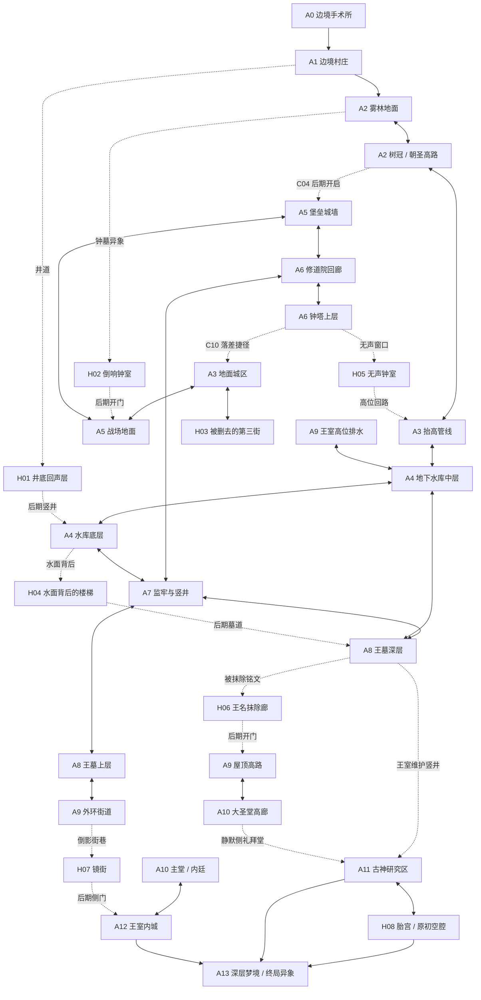

# 最终箱式世界地图设计 v1.0（垂直互联版）

> 分层细化补充：请同时参阅 [大区域—小区域—连接与升降机设计](BOX_WORLD_HIERARCHY_CN.md)。机器可读清单位于 `tools/world_map_topology.json` 的 `macro_regions`、`subregions`、`intra_region_connections` 与 `elevators`。

> 项目：Nereis-Hero  
> 分支：development  
> 状态：**最终空间设计基线；待按本方案实施与实机验收**  
> 本版取代 `BOX_WORLD_COMPLETE_DESIGN_CN.md` 的 0.1 拓扑基线作为后续地图施工依据。旧文档保留历史记录，不再作为空间结构的最终裁定。  
> 设计目标：不是把一串左右相连的关卡改名为“箱式地图”，而是构建一个能上下攀升、向地下坠落、绕回旧区域、从不同高度重新进入同一地点的 2D 互联世界。

## 1. 最终裁定：地图必须由“平面路线”改为“多层网络”

上一版的问题不在于区域数量，而在于主推进链太强、垂直路线只是个别区域的装饰性分层。即使登记了捷径，如果玩家大部分时间仍沿同一条地面路线从左向右推进，体验仍然接近线性关卡。

本版采用四条硬规则：

1. **每个核心枢纽至少有三种空间关系**：地面主路、上下层通路、通往已知区域的侧向/地下连接；并非每个区域都要三出口，但 A3、A4、A6、A8、A9 必须满足。
2. **垂直路径必须连接不同区域或改变旧区域的进入方式**。仅在同一屏幕摆几层平台，不算垂直互联。
3. **关键区域至少有两种到达方式或两种离开方式**，其中一种可以是后期开启的捷径。主线可以引导方向，但不能决定玩家每一步只能去哪。
4. **地图由空间地标而不是 UI 告知**：玩家能看见高塔、深井、断桥、瀑布/水渠、城墙和远处圣堂，却暂时无法抵达；能力、捷径与灵视把这些视觉承诺转化成可走路径。

本版仍保留 A0–A13 与 H01–H08 的区域身份，优先重新定义区域内部层级、连接的高度关系与路线用途，不凭空增加大量地图数量。H09 继续只是候选，不属于正式地图。

## 2. 全世界垂直剖面

地图不是一张单行横向长卷，而是至少五个互相穿插的高度带：

| 高度带 | 区域骨架 | 玩家空间体验 | 主要交通方式 |
|---|---|---|---|
| U3 天际/塔顶 | A2 树冠、A6 钟塔顶、A9 屋顶、A10 圣堂高廊、A12 城墙 | 远景、跳跃、坠落捷径、从高处看见旧区域 | 树冠、屋顶、钟塔、断桥、升降机 |
| U2 高架/上层 | A2 朝圣高路、A3 抬高管线、A5 城墙、A6 回廊、A9 外环高台 | 连接相距较远的区域，绕过地面危险 | 高架步道、破墙、吊桥、旧升降机 |
| U1 地面/城市层 | A1 村庄、A2 林地、A3 城区街道、A5 战场地面、A9 外环街道、A10 朝圣阶梯 | 主要战斗与初次导航层 | 地面道路、城门、街巷 |
| L1 地下/维护层 | A4 下水道与水库、A6 修道院下层、A7 监牢、A8 王墓上层、A9 排水道 | 低风险捷径与高风险近路交错，方向感由水流、管线与建筑根基辅助 | 井道、排水渠、维护竖井、牢房通道 |
| L2 深层/异象层 | A8 王墓深层、A11 古神研究区、H01/H04/H08 等隐藏空间、A13 终局异象 | 空间规则逐渐不可靠，灵视揭示原本不可见的连接 | 竖井、错位楼梯、隐藏门、异象通道 |

高度带不是独立的五张地图。每个主区域都可以横跨多个高度带，且同一地点可以从高层落入、从地下进入，或在后期通过升降机再次抵达。

## 3. 总体地图结构图

以下图是**开发者路线关系图**，不在正式游戏中向玩家展示。它强调上下连接与回环，不代表角色始终沿箭头单向推进。

图中的同一地区拆成了不同空间层，目的是强制设计者考虑“从哪里进入同一地区、处于哪一层、如何转层”，而不是把 A2、A3 等每个区域当作单条横向走廊。连接最终仍需映射到现有场景/区域切换系统；若某条连接无法在现有实现中成立，应调整场景结构，而不是把它留在图里当装饰。

## 4. 每个区域的最终空间布局

### A0 — 边境手术所与逃脱通道
- **层级**：封闭室内、下行手术井、侧向排污通道。
- **路线**：从手术台醒来 → 通过实验室主廊 → 下行绕过封锁 → 从排污通道逃到 A1。
- **垂直设计**：开场让玩家看见上层观察窗与下层排水沟；初期只可下行，避免序章过早变成开放迷宫。
- **出口**：C01 通往 A1；无强制回环。
- **用途**：教学、失忆与身体异变，不解释完整世界真相。

### A1 — 边境村庄（第一枢纽）
- **层级**：村道、屋顶/木栈道、老井底。
- **主要路线**：村道连接 A2；防卫事件后开启 C24 通往 A3 的地面/屋顶边缘近路。
- **垂直路线**：老井下降至 H01；H01 后期竖井接入 A4 底层，形成“村庄脚下就是地下水系”的空间揭示。
- **回访价值**：村庄事件前后改变巡逻、NPC位置、路障和屋顶通路；玩家再次回来时能从高处进入而非重复穿过整条村道。
- **地图角色**：安全感与导航锚点，远景中应能看到森林树冠、城区钟塔和高处圣堂。

### A2 — 雾林、钟墓与旧朝圣路
- **层级**：林地底层 → 坟冢/钟墓 → 树冠层 → 旧朝圣高路。
- **主路**：地面林道穿过钟墓外围，逐步引导玩家攀上树冠，再从高路进入 A3。
- **支路**：下沉墓坑与 H02；树冠边缘可俯视地面旧路，提示下方有尚未开启的区域。
- **连接**：C02 回 A1；C03 由树冠高路进入 A3；C04 从 A5 远端开启后形成高路回环。
- **空间承诺**：第一次看到但暂时无法跨越的断桥，应在后续从 A5 堡垒侧打开；不能只是地图上标了一条捷径。
- **战斗空间**：地面狭窄遭遇与树冠横向追击交替，避免全区只在同一地面高度战斗。

### A3 — 废弃城区（第一核心枢纽）
- **层级**：街道层、屋顶/二层、抬高管线、钟塔落差层、地下检查口。
- **地面层**：C08 通 A5，H03 入口锚定旧市场/第三街异常；街道要有明显的纵深地标与能辨方向的塔楼。
- **高层**：C05 从抬高管线进入 A4；C16 后期升降机从东侧屋顶通往 A9；C03 从西北树冠/断桥方向接入。
- **落差层**：C10 从 A6 钟塔落下后抵达城区中层/屋顶平台，不得落在地面门口。
- **回环**：A3 应至少有三种空间高度，且 C05、C10、C16 分属不同高度和不同视觉轮廓。
- **路线读图**：玩家能从街道看到高管线、从管线看到钟塔、从屋顶看见远处王城外环；后期回访时能将这些地标对应起来。

### A4 — 下水道、沉积大厅与旧水库（地下枢纽）
- **层级**：上层检查管廊、中层水道栈台、地面水库边缘、低位淹水沟、底层井道。
- **入口**：C05 从 A3 高管线进入上层；C12 从 A7 低位补给隧道进入低层；C07 从 A8 王墓中层水道进入中层；C23 从 A9 高位王室排水道接入上层；H01 后期井道落入底层。
- **出口**：C06 水闸/村庄老井回 A1；C07 通 A8；C12 通 A7；C23 通 A9；H04 从水库底层进入隐藏楼梯。
- **路线区别**：C12 是低、窄、危险的补给道；C07 是可站立的中层水道；C23 是高位排水道。三条路线必须在视觉、敌人和行走高度上显著不同。
- **空间结构**：玩家可先到水库底层看见上方封闭铁门，再从王墓侧开门后由中层横跨；可从高位水渠俯视低层敌人区域。
- **回环价值**：A4 是真正的多层交通枢纽，而非只供主角穿越的单线地下走廊。

### A5 — 旧战场与边境堡垒
- **层级**：战壕地面、坍塌城墙、箭楼、断桥/朝圣高路。
- **主路**：从 A3 地面进入战场，穿越战壕后攀上堡垒高墙，进入 A6 修道院回廊。
- **垂直连接**：从堡垒上层开启 C04 回到 A2 树冠高路；H02 次级出口在战场低位钟室附近开启。
- **战斗设计**：远程压制与近战冲锋利用高低差；战壕提供遮挡，城墙上有风险更高但更短的路。
- **探索价值**：高墙能看见 A2 的树冠路线与 A6 的钟塔轮廓，玩家理解它们处于同一地理空间。

### A6 — 修道院、回廊与钟塔（垂直建筑核心）
- **层级**：下层回廊、庭院、上层廊桥、钟塔中层、钟塔顶。
- **主路**：从 A5 城墙进入修道院，经庭院和回廊下行至 A7。
- **上层支路**：钟塔顶可看见 A3；开启 C10 后坠落/滑降至 A3 中层平台，形成跨区域垂直捷径。
- **隐藏路线**：H05 位于钟声完全消失的高位窗口，出口回到 A3 高层而非地面。
- **空间目标**：玩家在一张区域里多次经过同一庭院，但每次所处高度、看到的出口和敌人压力不同。
- **战斗设计**：狭窄回廊、上下夹击、钟塔垂直追击，避免单一横向竞技场。

### A7 — 监牢、忏悔井与维护竖井
- **层级**：监牢走廊、囚室下层、忏悔井、维护竖井上缘/底部。
- **主路**：从 A6 下层进入监牢，沿竖井与囚室层级向下，最后从维护竖井上行进入 A8 王墓。
- **捷径**：C12 由监牢补给口接入 A4 低位通道；必须让玩家从监牢看见下方管线或听到水流声，后期开门才有意义。
- **战斗设计**：囚室短支路可绕开精英，但会错过补给；竖井底部风险高但能打开通往 A4 的近路。
- **空间价值**：这是主线第一次明确教玩家“下降不一定是死路”，且下层与地下枢纽存在横向联系。

### A8 — 旧王墓与王室地下道
- **层级**：墓门平台、王族墓室、中层水道、深层铭文廊/维护井。
- **主路**：从 A7 竖井进入墓门平台，穿过墓室后抵达 A9 外环。
- **捷径**：C07 由墓侧打开通 A4 中层；C23 由 A9 王室排水道反向连回 A4；C15 从王墓维护井进入 A11。
- **隐藏内容**：H06 王名抹除廊贴近深层铭文，不与主路宝箱房混为一谈；后期从高位出口进入 A9 屋顶路线。
- **空间目标**：墓室上层是王权纪念，下层是维护结构，最深处才出现被隐藏的历史证据。

### A9 — 王城外环与废弃街区（后期枢纽）
- **层级**：下层街巷、外环广场、屋顶连廊、王室高位排水、内城服务门。
- **主路**：从 A8 进入外环后，玩家可选择地面穿过朝圣阶梯，或先攀屋顶寻找高路。
- **连接**：C16 高位旧升降机回 A3；C17 从屋顶高路进入 A10；C18 从内城侧开启后连接 A12；C23 从高位排水道落入 A4。
- **空间目标**：A9 必须成为全图第二个强枢纽，至少有一个上行出口、一个下行出口、一个横向主路与一条后期回环。
- **导航线索**：大圣堂钟面、王座城墙和旧城区钟塔在不同视点下反复出现，帮助玩家建立方向感。

### A10 — 大圣堂、朝圣阶梯与教会内廷
- **层级**：朝圣阶梯、主堂地面、侧廊、唱诗席/高廊、静默侧礼拜堂。
- **主路**：由 A9 上层入口进入大圣堂，再从主堂向下/向内抵达 A12。
- **垂直支路**：高廊可以俯视主堂战斗区；静默侧礼拜堂以秘密通路进入 A11，不用显眼的普通门标识。
- **空间目标**：同一教会空间上下层互相可见但未必立即可达；玩家可以从高廊看到封闭地面门的另一侧。
- **叙事承载**：教会的公开仪式空间在上层，维护/实验痕迹在下层，视觉上区分公开信仰与隐秘研究。

### A11 — 古神遗迹与深层研究区
- **层级**：王室维护井、教会实验层、古神遗留层、H08 胎宫/原初空腔。
- **入口**：C15 从 A8 王墓维护井进入；C19 从 A10 静默侧礼拜堂进入。
- **内部结构**：两条入口应落在不同高度/不同侧区，玩家第一次进来不立即看见全部区域；中层实验区连接下层古神遗留空间。
- **返回**：至少一条可稳定返回 A8/A10 的路线；不能把玩家锁在深层等结局。
- **终局关系**：A11 与 A13 的联系应根据游戏结局状态决定显现程度。H08 的进入条件与身体结合条件必须独立建模；身体结合不能自动等价于玩家已经理解真相，也不能未经论证成为所有主要结局的硬门槛。

### A12 — 王室内城与王座区
- **层级**：内城服务街、王室庭院、城墙步道、王座厅上层。
- **主路**：由 A10 主堂内侧进入王室庭院，向上抵达王座厅。
- **捷径**：C18 从内城服务门打开回 A9 下层/中层，不能直接把玩家传到同一扇门前。
- **路线分层**：王座厅入口与城墙高路不是同一条横向走廊；玩家可以从城墙看到庭院和王座厅入口。
- **结局空间**：王权路线的终局入口与 A11 深层路线都可通向 A13，但触发条件不同，空间提示也不同。

### A13 — 深层梦境与终局异象
- **层级**：不遵守常规地理的异象空间。
- **原则**：它是结局场景集合，不是普通的可自由探索区域；空间可以违反前述层级规则，但必须服务于结局主题与玩家状态。
- **入口**：从 A11/H08 与 A12 进入的路径应保持语义差异；不可仅凭到达同一终点就视为同一条路线。
- **分支**：不同结局使用不同空间转换、地标扭曲和战斗结构，不把所有路线压缩成同一 Boss 房换皮。

## 5. 隐藏区域的垂直化定稿

| ID | 嵌入层级 | 入口发现方式 | 空间结构 | 回报/出口原则 |
|---|---|---|---|---|
| H01 井底回声层 | A1 井下 → A4 底层 | 井绳、回声与灵视异常 | 先下降，再从侧洞进入旧水渠 | 早期发现空间异常；后期开启至 A4 的竖井 |
| H02 倒响钟室 | A2 墓坑底层 | 逆序钟声、钟体影子与灵视 | 低位入口、上层出口可从另一侧看见 | 到达 A5 后开启低位侧门，形成森林—战场纵向回路 |
| H03 被删去的第三街 | A3 地面街道背后 | 被墙体遮挡的街道轮廓、重复门牌 | 与普通街道平行但存在空间错位 | 线索揭露城市记忆被删改；后期出口接 A9 低层 |
| H04 水面背后的楼梯 | A4 水库底层 | 倒影中多出一级台阶 | 水下/水面边缘的短竖向错层 | 通向 A8 深层，不直接绕过王墓关键门 |
| H05 无声钟室 | A6 钟塔上层 | 到达钟塔高处后声音突然缺失 | 通过钟架内部向下穿行 | 回到 A3 高架层，与 C10 形成不同高度的回路 |
| H06 王名抹除廊 | A8 墓室深层 | 铭文缺字与可读阴影 | 窄长竖向铭文廊，尽头有高位升出口 | 后期接入 A9 屋顶；奖励以历史证据为主 |
| H07 镜街 | A9 低层积水街巷 | 倒影中的街巷比现实多一条分支 | 先向下进入镜面错层，再从侧门上升 | 抵达 A12 后开启内城侧门；奖励与路线/证据相关 |
| H08 胎宫／原初空腔 | A11 最深层 | 灵视与环境反馈叠加，逐渐显现不可能的结构 | 下降式空间，视觉尺度逐步失真 | 可通 A13 的隐藏入口；进入条件、关系状态、结局资格分开处理 |

隐藏区域不是全都从左侧走进去再从右侧走出来。它们应有下降、攀升、穿墙、从高处回到熟悉空间等不同空间动词。

## 6. 连接与回环必须达到的最终形态

现有 C01–C24 作为区域级连接 ID 继续保留，但实施时必须把关键连接映射到具体高度层。尤其是：

- C03：A2 树冠层 ↔ A3 屋顶/高层，不是两张地面图的边界切换。
- C04：A2 朝圣高路 ↔ A5 堡垒城墙，远端开启后形成高架回环。
- C05：A3 抬高管线 → A4 上层检查廊。
- C06：A4 水库底层/水闸 → A1 老井出口，作为安全的回村捷径；H01 是相邻但独立的隐藏入口。
- C07：A4 中层水道 ↔ A8 墓道中层。
- C08：A3 地面街道 ↔ A5 战场地面，保留直接主路。
- C10：A6 钟塔高位 → A3 中层落差平台。
- C12：A7 监牢低位 → A4 低位补给隧道。
- C15/C19：A8 与 A10 从不同高度进入 A11，形成两条不同风险/信息路线。
- C16：A3 东侧屋顶升降机 ↔ A9 屋顶高路。
- C17：A9 屋顶 ↔ A10 圣堂高廊；C20 主线进入 A12 则从主堂/内廷层推进。
- C23：A9 王室高位排水道 ↔ A4 上层水渠，不得与 C12/C07 共用同一地面入口。
- C24：A1 村庄 ↔ A3 城区近路应从村庄上层/防卫设施接入城区侧缘，而不是简单添加一条地面门。

宏观环路的最终空间目标：

1. **边境环路**：A1 → A2 地面/树冠 → A3 高层/地面 → A4 上下层 → A1 井道。玩家既能绕远走地面，也能用地下与高架切换。
2. **中层环路**：A3 地面 → A5 战壕/城墙 → A6 回廊/钟塔 → A3 中层落差。回到城区时位置和高度改变，玩家必须重新辨认。
3. **王国深层环路**：A4 底层/中层 → A7 低路或 A8 墓道 → A9 地面/屋顶 → A4 高位排水。环路至少跨越三个高度带。
4. **后期高架环路**：A3 屋顶 → A9 屋顶 → A10 高廊 → A12 城墙；C18 打开后从内城回到 A9 下层，形成“高进低出”的大尺度回路。
5. **隐藏纵深链**：H01/H04/H06/H07 通过不同层级与主区交叉，不允许所有隐藏区都成为不影响主地图的孤立小房间。

## 7. 地图施工前必须遵守的边界

- 这是空间设计的最终基线，不是已经实现的事实；所有连接需在场景里有真实平台、梯子/坡道/落差、门或可见的空间过渡。
- 不要在每个区域平均分配三层平台。垂直结构必须由地点的建筑逻辑决定：森林用树冠，修道院用塔楼，城市用屋顶与管线，地下区用水渠和竖井。
- 不允许通过大量隐形墙、无反馈传送或不合理出生点伪造互联。
- 不把敌人和奖励随意塞满每条支路；空间先明确后，敌人配置和奖励才根据视线、风险、路径价值布置。
- 不在剧情尚未设计时，把临时灰盒事件写成已确认世界事实。空间可以预留线索位，但具体剧情事实保持待定。
- 正式版不显示完整开发者地图；玩家仅通过探索、地标、声音、环境与灵视建立心智地图。
- 不触发 GitHub Actions。未在 Godot 运行的改动必须明确标注为静态设计/源码状态。

## 8. 施工与验收顺序

### 阶段 1：A2–A4 垂直箱庭切片
- A2 地面、墓坑、树冠高路必须能彼此辨认。
- A3 地面、屋顶、抬高管线必须能真实通行，并与 C03/C05/C10/C16 的入口高度匹配。
- A4 至少实现底层、中层、高层三条明确交通线。
- 验证 L01 不是单纯绕回起点：玩家能通过井道/水渠改变进入 A1/A4 的高度与位置。

### 阶段 2：A5–A8 战场—修道院—监牢—王墓
- 战场战壕和城墙分层；修道院的钟塔要成为可读的空间地标；监牢竖井要有上下层路线；王墓水道要连接 A4 中层。
- 验证 L02 与 L03 至少各有一条不经过原路主走廊的回路。

### 阶段 3：A9–A12 后期高架网络
- 屋顶、圣堂高廊、王室城墙和高位排水形成跨区域路线。
- C16/C17/C18/C23 必须分别对应高层、主层、低层回程，不得集中到同一条平地走廊。

### 阶段 4：H01–H08 与 A11/A13
- 每个隐藏区至少采用一种与其他隐藏区不同的空间发现方式。
- 检查进入、返回、奖励持久化、灵视反馈、结局条件独立性。

### 阶段 5：最终地图冻结
满足以下条件才冻结地图设计并开始大规模剧情填充：
- 每个区域有明确的垂直剖面和入口/出口层级。
- 核心枢纽拥有真实多层连接，不只在纸面上有多条边。
- 所有宏观捷径都能缩短路程或改变进入高度/方向。
- 玩家能从地标推断空间关系，不依赖完整地图 UI。
- 开发者档案补齐敌人、奖励、惩罚、隐藏内容和触发条件。
- 静态验证与 Godot 实机验收分别记录，不能互相替代。

## 9. 最终结论

**本版才是后续施工采用的最终空间设计基线。** 它不再把“有 24 条连接、3 条回环”视为箱庭完成，而是要求这些连接跨越真实高度层，改变玩家的行进方向、回访方式和对旧区域的理解。

地图设计冻结后，下一阶段才进入剧情填充：先为每个区域定义叙事职责、人物到场理由、碎片线索、关键事件与回访变化；不要反过来用剧情把不成立的空间硬解释成成立。
