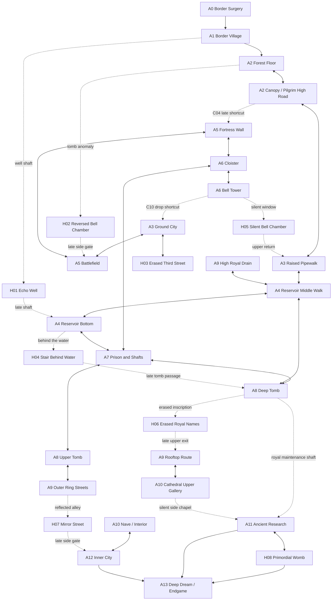

# Final Box-World Map Design v1.0 — Vertically Interconnected World

> Project: Nereis-Hero  
> Branch: development  
> Status: **final spatial design baseline; implementation and in-engine acceptance pending**  
> This document supersedes version 0.1 of `BOX_WORLD_COMPLETE_DESIGN_EN.md` as the construction authority. The earlier document remains historical context, not the final spatial ruling.  
> Goal: do not rename a left-to-right chain of levels as a box-world. Build a 2D interconnected world where players climb, descend, loop back into old areas, and re-enter familiar places from different elevations.

## 1. Final ruling: replace flat routing with a multi-layer network

The previous design's weakness was not region count. Its critical flaw was an overly dominant progression chain, with vertical routes treated as local decoration. Even with shortcuts listed, a player who mostly walks right along one ground lane is still playing a linear level sequence.

This version enforces four rules:

1. **Every major hub must support at least three spatial relationships**: ground route, vertical route, and a lateral/underground connection to another known area. Not every region needs three exits, but A3, A4, A6, A8, and A9 do.
2. **Vertical routes must connect regions or change how an old region is entered.** Several platform tiers on one screen alone do not constitute vertical interconnection.
3. **Every key region needs at least two meaningful ways to arrive or leave**, one of which may be a late shortcut. The main route may orient the player, but must not dictate every step.
4. **Landmarks, not UI, communicate space.** Players see the tower, deep well, broken bridge, water channel, walls, and distant cathedral before they can reach them. Abilities, shortcuts, and Insight convert these visual promises into traversable routes.

Keep A0–A13 and H01–H08. Redefine internal elevation bands and connection purposes before adding many new regions. H09 remains a candidate, not part of the official map.

## 2. World cross-section

The world is not a single horizontal scroll. It has at least five interwoven elevation bands:

| Band | Region skeleton | Experience | Typical traversal |
|---|---|---|---|
| U3 Skyline / tower tops | A2 canopy, A6 bell tower, A9 roofs, A10 upper galleries, A12 walls | Long views, jumps, drop shortcuts, seeing old places from above | Canopy, roofs, tower, broken bridges, lifts |
| U2 Raised routes / upper floors | A2 pilgrim road, A3 pipewalk, A5 walls, A6 cloisters, A9 raised ring | Long-range connections that bypass ground threats | Raised walkways, breaches, suspended bridges, lift |
| U1 Ground / urban layer | A1 village, A2 forest, A3 streets, A5 battlefield, A9 outer ring, A10 stairs | Primary combat and first-time navigation | Roads, gates, alleys |
| L1 Underground / service layer | A4 sewers and reservoir, A6 undercroft, A7 prison, A8 upper tomb, A9 drains | Interleaved safe shortcuts and dangerous routes, navigated by water and building foundations | Wells, drains, maintenance shafts, prison tunnels |
| L2 Deep / anomalous layer | A8 deep tomb, A11 research ruins, H01/H04/H08, A13 endgame | Unreliable spatial rules and Insight-revealed connections | Shafts, misaligned stairs, hidden doors, anomalous passages |

These are not five separate maps. Major regions span multiple bands. The same place may be entered from above, reached from below, or revisited later via a lift.

## 3. World network diagram

This is a **developer route diagram**, never exposed to players as a complete map. It deliberately separates sub-areas by elevation so designers must consider where a transition arrives and how elevation changes routing.

The region is split into sub-areas in this diagram to force decisions about elevation, entry side, and vertical transitions. Every link still needs to map to the existing scene-transition system. If a connection cannot be realized, revise the scene design rather than leaving it as decorative documentation.

## 4. Final spatial layout by region

### A0 — Border Surgery and Escape Route
- **Layers:** sealed interior, descending surgery shaft, lateral waste channel.
- **Route:** wake at the operating table → cross the lab corridor → descend around the blockade → escape through the waste channel to A1.
- **Vertical intent:** show an upper observation window and lower drain early; initially permit descent only so the prologue does not become an open maze.
- **Exit:** C01 to A1; no mandatory loop.
- **Purpose:** tutorial, amnesia, bodily alteration—not a full explanation of the world's truth.

### A1 — Border Village (first hub)
- **Layers:** village lane, roofs/wooden walkways, well bottom.
- **Main route:** village lane to A2; after the village-defense event, C24 opens a ground/roof-edge shortcut to A3.
- **Vertical route:** the old well descends to H01; a late shaft from H01 connects to A4's bottom layer, revealing that the village sits above the underground water system.
- **Revisit value:** village events alter patrols, NPC positions, barricades, and roof access. On return, the player can enter from above instead of crossing the whole lane.
- **Navigation:** a safe anchor with distant views of the canopy, city tower, and cathedral.

### A2 — Mist Forest, Bell Tomb, and Old Pilgrim Road
- **Layers:** forest floor → burial mound/bell tomb → canopy → old pilgrim high road.
- **Main route:** ground trail skirts the bell tomb and gradually leads upward into the canopy, then into A3.
- **Branches:** sunken tomb and H02; from the canopy, players can look down onto a ground route not yet accessible.
- **Links:** C02 to A1; C03 from canopy to A3; C04 forms a high-road loop after being opened from A5.
- **Spatial promise:** a broken bridge is visible before it can be crossed and later opens from the fortress side. It must be a real traversal shortcut, not a line in a diagram.
- **Combat:** alternate narrow ground encounters and canopy pursuit instead of fighting on one flat lane.

### A3 — Abandoned City (first major hub)
- **Layers:** street, rooftops/second floors, raised pipewalk, bell-tower-drop landing, sewer inspection hatch.
- **Ground:** C08 to A5; H03 is anchored to the old market/erased street anomaly; streets need strong depth landmarks and a readable tower silhouette.
- **Upper levels:** C05 enters A4 from the raised pipewalk; C16 is a late lift from the eastern rooftops to A9; C03 arrives from the canopy/broken-bridge side.
- **Drop layer:** C10 drops from A6 into a mid-level city platform, never onto a ground-level doorway.
- **Loop:** A3 needs at least three genuine elevations. C05, C10, and C16 must occupy distinct heights and visual silhouettes.
- **Wayfinding:** from the street, see the pipewalk; from the pipewalk, see the tower; from the rooftops, see the distant outer ring. Revisit turns these silhouettes into a coherent mental map.

### A4 — Sewers, Sedimentation Hall, and Old Reservoir (underground hub)
- **Layers:** upper inspection gallery, middle waterway ledge, reservoir edge, low flooded channel, bottom shaft.
- **Entries:** C05 from A3's raised pipewalk; C12 from A7's low supply tunnel; C07 from A8's middle waterway; C23 from A9's high royal drain; late H01 shaft into the bottom.
- **Exits:** C06 watergate/well return to A1; C07 to A8; C12 to A7; C23 to A9; H04 from the reservoir bottom.
- **Distinct route identities:** C12 is low, narrow, and dangerous; C07 is a walkable middle ledge; C23 is a high drain. They must differ visibly, spatially, and in encounter design.
- **Spatial structure:** see a locked iron gate from below, then open it from the tomb and cross the middle ledge. From the high channel, overlook enemy spaces below.
- **Purpose:** a true multi-level transport hub, not a single underground corridor.

### A5 — Old Battlefield and Border Fortress
- **Layers:** trench floor, collapsed wall, watchtower, broken bridge/pilgrim high road.
- **Main route:** enter from A3 at ground level, cross trenches, climb the fortress wall, and enter A6's cloister.
- **Vertical links:** open C04 from the upper fortress wall back to A2's canopy/high road; H02's secondary exit opens near a lower battlefield bell chamber.
- **Combat:** ranged pressure and melee charges exploit elevation; trenches provide cover while the wall offers a riskier but shorter route.
- **Spatial payoff:** from the wall, the player sees A2's canopy and A6's tower, establishing a shared geography.

### A6 — Monastery, Cloister, and Bell Tower (vertical architecture hub)
- **Layers:** lower cloister, courtyard, upper gallery, middle bell tower, tower top.
- **Main route:** enter from A5's wall, cross the courtyard and cloister, descend to A7.
- **Upper branch:** the tower top overlooks A3; C10 becomes a drop/slide to an A3 mid-level platform, a cross-region vertical shortcut.
- **Secret:** H05 sits at a high window where bell sound abruptly disappears; its exit returns to A3's upper layer, not the ground.
- **Intent:** pass the same courtyard at different heights with different exits and enemy pressure.
- **Combat:** narrow galleries, vertical crossfire, and tower pursuit—not one horizontal arena.

### A7 — Prison, Well of Confession, and Maintenance Shaft
- **Layers:** cell corridor, lower cells, confession well, top and bottom of maintenance shaft.
- **Main route:** from A6's lower level, descend through cells and shafts, then climb the maintenance shaft into A8's tomb.
- **Shortcut:** C12 connects the prison supply hatch to A4's low route. From the prison, players should see pipes or hear water below before opening the shortcut.
- **Combat:** short cell branches may bypass an elite at the cost of supplies; the shaft bottom is dangerous but can unlock a route to A4.
- **Purpose:** teach that descending does not necessarily mean reaching a dead end.

### A8 — Old Royal Tomb and Royal Undercroft
- **Layers:** tomb entrance platform, royal chambers, middle waterway, deep inscription gallery/maintenance shaft.
- **Main route:** enter from A7's shaft, cross the chambers, reach A9.
- **Shortcuts:** C07 opens to A4's middle layer; C23 links A9's royal drain back to A4; C15 uses a maintenance shaft to reach A11.
- **Secret:** H06 lies beside the deep inscriptions, not in a generic treasure room; its later upper exit reaches A9's rooftop route.
- **Intent:** upper tombs commemorate royal power; lower layers reveal maintenance infrastructure; only the deepest layer exposes erased history.

### A9 — Royal Outer Ring and Abandoned District (late hub)
- **Layers:** lower alleys, outer plaza, rooftop walks, high royal drain, inner-city service gate.
- **Main route:** after entering from A8, choose ground streets toward the pilgrim stair or climb rooftops first.
- **Links:** C16's high lift returns to A3; C17 connects the rooftops to A10; C18 links to A12 once opened from the inner city; C23 drops from the high drain into A4.
- **Hub requirement:** at least one upward exit, one downward exit, one lateral main route, and one late loop.
- **Navigation:** cathedral face, royal walls, and the old city tower recur from multiple viewpoints.

### A10 — Grand Cathedral, Pilgrim Stair, and Church Interior
- **Layers:** pilgrim stair, main nave, side aisles, choir/upper gallery, silent side chapel.
- **Main route:** enter from A9's upper route, then move down/inward from the nave toward A12.
- **Vertical branch:** the gallery overlooks the nave combat space; the silent chapel is a secret entry to A11, not a conspicuous ordinary door.
- **Intent:** upper and lower parts of the same church remain visible to each other but are not immediately reachable.
- **Narrative staging:** public worship occupies the upper/visible space; maintenance and experiments leave traces below.

### A11 — Ancient Ruins and Deep Research Complex
- **Layers:** royal maintenance shaft, church lab, ancient residue layer, H08 primordial womb.
- **Entries:** C15 from A8's royal shaft; C19 from A10's silent side chapel.
- **Internal structure:** entries arrive at different elevations/sides. The first visit should not reveal the entire complex; the lab connects to the deeper residue layer.
- **Return:** at least one reliable route back to A8/A10; do not trap the player in the deep layer while waiting for an ending.
- **Endgame:** access to A13 depends on ending state. H08 access, relationship state, and ending eligibility must be independent variables. Intimacy alone must not automatically equal understanding, nor become a hard gate for all major endings without explicit justification.

### A12 — Royal Inner City and Throne
- **Layers:** service streets, royal courtyard, wall walk, upper throne hall.
- **Main route:** enter from A10's inner nave, cross the royal courtyard, ascend to the throne hall.
- **Shortcut:** C18 opens from the inner city back to A9's lower/middle layer, not directly in front of the same door.
- **Layering:** the throne entrance and wall walk are not one horizontal corridor; from the wall, the player can see the courtyard and throne entrance.
- **Endings:** the royal route and deep-research route can both lead to A13, but with different conditions and spatial cues.

### A13 — Deep Dream and Endgame Anomaly
- **Layers:** anomalous spaces that do not obey ordinary geography.
- **Rule:** a set of ending spaces, not a normal free-roaming region. Spatial impossibility is allowed only when it serves the ending and player state.
- **Entries:** paths from A11/H08 and A12 must retain distinct meanings; arriving at one endpoint does not make the routes equivalent.
- **Branches:** each ending should use different spatial transitions, landmark distortion, and encounter structure—not the same boss room with a different skin.

## 5. Vertical design for hidden regions

| ID | Embedded layer | Discovery | Spatial structure | Payoff / exit |
|---|---|---|---|---|
| H01 Echo Well | A1 well → A4 bottom | Rope, echo, Insight anomaly | Descend first, then enter a side channel | Early spatial anomaly; late shaft to A4 |
| H02 Reversed Bell Chamber | A2 lower tomb | Reversed bell sound, bell shadow, Insight | Low entry; upper exit visible from the other side | Opens a low side gate at A5, creating a forest/battlefield vertical loop |
| H03 Erased Third Street | Behind A3 ground street | Occluded street silhouette, repeated door numbers | Parallel to ordinary streets but spatially misaligned | Evidence of erased urban memory; late exit to A9 lower level |
| H04 Stair Behind Water | A4 reservoir bottom | Reflection shows an extra step | Short vertical misalignment at the water edge | Reaches A8 deep layer without bypassing key tomb gates |
| H05 Silent Bell Chamber | A6 upper tower | Sound abruptly vanishes near the top | Descend through the inner bell frame | Returns to A3 upper layer, distinct from C10 |
| H06 Erased Royal Names | A8 deep tomb | Missing inscriptions and readable shadows | Narrow vertical inscription gallery with upper lift exit | Late connection to A9 rooftops; evidence-focused reward |
| H07 Mirror Street | A9 flooded lower alleys | Reflection contains an extra branch | Descend into a mirrored offset, then rise through a side gate | Opens an inner-city side gate after A12 is reached |
| H08 Primordial Womb | Deepest A11 layer | Insight and environmental feedback gradually reveal impossible geometry | Descending space with distorted scale | Hidden route to A13; access, relationship, and ending flags remain separate |

Hidden areas must not all follow the pattern “enter from the left, exit on the right.” Use distinct spatial verbs: descend, climb, pass through a wall, drop back into a familiar place from above.

## 6. Required final form of connections and loops

Keep existing region-level IDs C01–C24, but map critical links to concrete elevation layers during implementation. In particular:

- C03: A2 canopy ↔ A3 rooftop/upper city, not a ground-boundary transition.
- C04: A2 pilgrim high road ↔ A5 fortress wall; the far-side unlock creates an elevated loop.
- C05: A3 raised pipewalk → A4 upper inspection gallery.
- C06: A4 reservoir bottom/watergate → A1 well exit, a safe village shortcut; H01 remains a nearby but separate secret entry.
- C07: A4 middle waterway ↔ A8 middle tomb route.
- C08: A3 ground street ↔ A5 battlefield ground, retaining a direct main route.
- C10: A6 tower top → A3 mid-level drop landing.
- C12: A7 prison low level → A4 low supply tunnel.
- C15/C19: A8 and A10 enter A11 from different elevations, creating distinct risk/information routes.
- C16: A3 eastern rooftop lift ↔ A9 rooftop route.
- C17: A9 rooftop ↔ A10 upper gallery; C20 progresses from the nave/interior to A12.
- C23: A9 high royal drain ↔ A4 upper channel; it must not share the same ground entrance as C12/C07.
- C24: A1 village ↔ A3 shortcut should enter at the city's edge from an upper defensive route, not add another flat ground door.

Target loop forms:

1. **Border loop:** A1 → A2 ground/canopy → A3 upper/ground → A4 multiple levels → A1 well. Players can choose ground travel or change elevation via underground and raised routes.
2. **Mid-layer loop:** A3 ground → A5 trenches/wall → A6 cloister/tower → A3 mid-level drop. Returning changes both position and elevation.
3. **Royal deep loop:** A4 bottom/middle → A7 low route or A8 tomb → A9 ground/roof → A4 high drain. At least three elevation bands are involved.
4. **Late elevated loop:** A3 rooftops → A9 rooftops → A10 gallery → A12 walls; C18 returns from the inner city to A9 lower level, forming a large high-entry/low-exit loop.
5. **Hidden depth chain:** H01/H04/H06/H07 intersect the main map at different elevations; they cannot all be isolated bonus rooms.

## 7. Constraints before construction

- This is the final spatial design baseline, not a claim of implementation. Every connection needs real platforms, ladders/slopes/drops, doors, or a readable spatial transition.
- Do not give every region three identical platform tiers. Verticality must follow place logic: canopy in the forest, towers in the monastery, rooftops/pipes in the city, channels/shafts underground.
- Do not fake interconnection with invisible walls, silent teleports, or unreasonable spawn positions.
- Do not scatter enemies and rewards randomly across every branch. Establish space first; place encounters and rewards according to sightlines, risk, and route value.
- Do not turn temporary graybox events into confirmed lore before narrative design. Reserve clue locations while keeping the facts undecided.
- The released game must not show the complete developer map. Players build their mental map through exploration, landmarks, sound, environment, and Insight.
- Do not trigger GitHub Actions. Changes not run in Godot must be marked as static design/source state.

## 8. Construction and acceptance sequence

### Stage 1: A2–A4 vertical slice
- A2 ground, tomb pit, and canopy routes must be distinguishable.
- A3 ground, rooftops, and raised pipewalk must be traversable and align with C03/C05/C10/C16.
- A4 must have distinct bottom, middle, and upper routes.
- Verify L01 is not merely a return to the starting point: the player changes entry position/elevation through the well and channels.

### Stage 2: A5–A8 battlefield, monastery, prison, tomb
- Layer trenches and fortress walls; make the bell tower a readable landmark; give the prison shaft real vertical routes; connect the tomb waterway to A4's middle layer.
- Verify L02 and L03 each include at least one loop that does not retrace the original main corridor.

### Stage 3: A9–A12 late elevated network
- Roofs, cathedral gallery, royal walls, and high drains form cross-region routes.
- C16/C17/C18/C23 must map to distinct high/main/low returns, not one flat corridor.

### Stage 4: H01–H08 and A11/A13
- Give each hidden area a discovery method distinct from most others.
- Verify entry, return, reward persistence, Insight feedback, and independent ending conditions.

### Stage 5: Freeze the final map
Freeze the map design and begin major narrative filling only when:
- Every region has a defined vertical section and elevation for each entrance/exit.
- Core hubs have real multi-level connections, not just multiple graph edges on paper.
- Every macro shortcut reduces travel or changes approach elevation/direction.
- Landmarks let players infer spatial relations without a complete map UI.
- The developer dossier covers enemies, rewards, penalties, secrets, and trigger conditions.
- Static checks and Godot runtime acceptance are tracked separately.

## 9. Final conclusion

**This version is the final spatial design baseline for subsequent construction.** It no longer treats “24 connections and three loops” as proof of a box-world. Those links must cross real elevation bands and change traversal, revisits, and the player's understanding of familiar places.

Once the map design is frozen, narrative filling begins: define each region's narrative role, why characters arrive, fragment clues, key events, and revisit changes. Do not use story explanations to paper over spatial designs that do not work.
