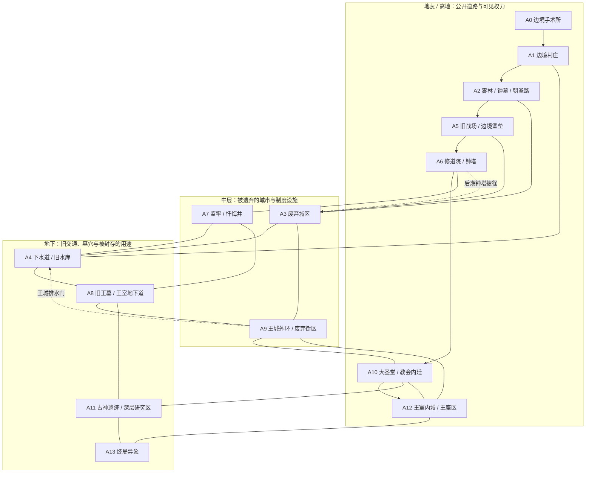

# Nereis Hero 完整世界地图区划提案（中文）

> **版本：** Complete World Atlas Draft 1.0  
> **分支：** development  
> **用途：** 作为全游戏地图制作的统一区划基准；不是已实现的场景清单。  
> **规模目标：** 普通通关约 40 小时；真结局路线约 60 小时；全收集与深度探索约 80–120 小时。以上均为规划目标，需通过试玩数据校准。  
> **关联文档：** [世界地图总纲](./WORLD_MAP_MASTER_PLAN_CN.md)、[第一阶段关卡拓扑](./LEVEL_TOPOLOGY_PHASE_1_CN.md)、[全游戏区域网络](./WORLD_NETWORK_TOPOLOGY_CN.md)。

## 地图总图

完整区划示意图：[查看 SVG 全图](./assets/COMPLETE_WORLD_MAP_ATLAS.svg)。图中主路线、后期开启的捷径、可选连接使用不同线型；子区划名称与连接规则以本文为准。

## 1. 目标：先确定完整地图，再逐区制作

本文件把整个王国划分为 **14 个主要区域、约 55 个地图子区划**。主要区域是玩家能够辨认的独立地理 / 生态 / 建筑单元；子区划是地图上可以命名的片区；每个子区划再由多个房间、横版屏幕或 Godot 场景组成。

这些数字是地图规划单位，不是要求做成 14 个大关卡或恰好 55 个场景。区域的大小应该有明显差异：村庄紧凑、废弃城区复杂、下水道纵深大、终局区域短而密集。

参考《空洞骑士》的地图设计方法时，我们借鉴的是 **区域有鲜明身份、中央连接区、多层互通、远路进入后从另一侧打开捷径、隐藏区域不必服务普通通关**，而不是照搬其地图形状、地点名称或美术设计。玩家第一次看见的是一部分地图；随着探索、地图记录和捷径开启，逐步理解整个王国。

## 2. 王国的空间骨架

地图采用横向延展、纵向分层的 2D 地理关系：

- **西部边境：** A0 边境手术所、A1 村庄、A2 森林与旧朝圣路。开局远离王城，但能从村庄和山道远望东侧高处的大圣堂。
- **西部中层：** A3 废弃城区。它是第一处高连接度区域，连接森林、地下排水系统、旧战场和王城外缘的旧路。
- **中部高地：** A5 旧战场与边境堡垒、A6 修道院。高处能看见钟塔、王城外环与教会建筑；这些地标最初不可直接到达。
- **中部地下：** A4 下水道与旧水库、A7 监牢与忏悔井、A8 旧王墓与王室地下道。它们不是同一时代建造的设施，而是互相覆盖、后来被打通或封锁的结构。
- **东部王城：** A9 王城外环、A10 大圣堂与教会内廷、A12 王室内城。玩家可以从街道、宗教建筑与地下道以不同高度进入。
- **最深层：** A11 古神遗迹与深层研究区，以及与其相连的 A13 终局异象。它们位于地理最深处和认知最不可靠的位置；不应在普通路线中被完整解释。

### 全图区划示意

以下示意图强调空间邻接与层级，不按比例，也不代表玩家能在第一次经过时自由通行。

## 3. 完整的 14 个主要区域与地图子区划

这里的子区划是正式地图命名候选。进入实际制作后可以调整房间拆分，但不应轻易改变主要区域之间的空间关系。

### A0 — 边境手术所与逃脱通道（序章）

**身份：** 教会在偏远地区设置的外科 / 研究前哨，规模小，危险集中。它不是王城地下深层研究区的本体，而是教会研究网络的一处分支设施。

- **A0.1 消毒病房：** 主角醒来的封闭空间，沿用现有序章。
- **A0.2 实验走廊：** 现有敌人与实验残迹所在的压迫性通道。
- **A0.3 山腹逃生道：** 单向逃离路线，借山体和废弃运送通道把主角带到村庄附近。

**地图职责：** 交代“主角曾被研究”，但不直接告诉玩家研究的全部对象、主角身份和设施坐标。不要把 A0 扩建成大型首关。

### A1 — 边境村庄（第一个枢纽）

**身份：** 全游戏最重要的生活锚点。它不大，却会因人物、支线和捷径而反复变得重要。

- **A1.1 石井广场：** 村庄视觉中心；远眺东面的王城 / 大圣堂。
- **A1.2 旅店与公共屋：** 休息、传闻与重返后的人物状态。
- **A1.3 蜜忒的小路：** 蜜忒相关的日常遭遇和可选停留，不显示恋爱数值。
- **A1.4 废弃磨坊：** 村民生计与边境衰败的环境证据。
- **A1.5 村外林门：** 通往 A2 的明确主出口。
- **A1.6 老井与检修口：** 初期封闭；A4 开启回水闸后成为地下返回捷径。

**关键设计：** 玩家能看到王城，却不能沿直线过去。村庄要有安全感、熟悉度和关系变化，不能只是一次性新手村。

### A2 — 雾林、钟墓与旧朝圣路（首个野外区）

**身份：** 介于边境生活与王国旧道路之间。这里第一次让玩家怀疑现有教会并不是这片土地上最古老的力量。

- **A2.1 雾林边缘：** 主路与第一批野外遭遇。
- **A2.2 猎人谷道：** 可选支路、遗物与地方性传闻。
- **A2.3 断桥观景台：** 远望废弃城区与王城建筑；有可见但暂不可达的平台。
- **A2.4 旧朝圣石阶：** 被后世教会符号覆盖的旧路。
- **A2.5 钟墓墓园：** 可选探索与矛盾的墓碑记录。
- **A2.6 地下钟室：** 小型高风险支区；用声音与结构讲述异常，不靠长篇说明文本。
- **A2.7 山体裂隙：** 一条较危险的路线进入 A3 外街，并与森林的回环相连。

**连接：** A1、A3、A5（后期开启的旧朝圣高路）。钟墓不应成为普通通关的强制作业。

### A3 — 废弃城区（第一个大型互通枢纽）

**身份：** 玩家第一次需要靠记忆地标理解上下层关系的大型区域。它既是曾经的生活城区，也有一部分被教会征用或封锁。

- **A3.1 外街入口：** 从 A2 裂隙进入，先俯瞰城区的高低层。
- **A3.2 倒塌住宅区：** 短房间、断墙、二层窗口和室内小环路。
- **A3.3 旧市场：** 区域中心与方向锚点。
- **A3.4 封锁大道：** 通往东侧的旧道，初期被挡住。
- **A3.5 屋顶木桥：** 上层路线，提供远景和风险奖励。
- **A3.6 旧礼拜堂：** 上层窗洞与下层大厅互相可见。
- **A3.7 地下排水口：** 通往 A4 的主要入口。
- **A3.8 排水检修间：** 从 A4 开启后连回市场附近，缩短回程。
- **A3.9 旧升降井：** 早期可见但不可用；后续可连接 A9 或中层路线。

**至少要成立的两个环路：** 外街—住宅上层—屋顶木桥—礼拜堂上层；市场—地下排水口—A4—排水检修间。二者不必首次探索即全部开放。

### A4 — 下水道、沉积大厅与旧水库（第一条大型捷径）

**身份：** 被后世改造的旧交通系统。教会安装的管线和王朝旧石构并置，玩家可以自行观察出年代与用途的冲突。

- **A4.1 入口闸室：** 从 A3 地下排水口进入。
- **A4.2 分流渠：** 主要分岔；一侧水声来自封闭区域。
- **A4.3 维护桥：** 高低落差与单向下落。
- **A4.4 沉积大厅：** 战斗、探索和结构年代证据。
- **A4.5 回水闸室：** 打开后改变部分水位，并解锁捷径。
- **A4.6 旧水库：** 区域中心，水位变化改变可走路径。
- **A4.7 王墓外廊：** 通往 A8 的封闭远景入口。
- **A4.8 村庄旧井出口：** 返回 A1 的捷径出口。

**解锁结果：** 村庄旧井打开、城区检修间可从地下连回、王墓外廊的位置被玩家记住。这是全图第一个有意义的空间顿悟。

### A5 — 旧战场与边境堡垒

**身份：** 王国扩张的代价。它不是传统的“怪物荒野”，而是被官方英雄叙事遗弃的军事地带。

- **A5.1 断旗平原：** 从 A3 或 A2 的后期开启高路进入。
- **A5.2 塌陷战壕：** 利用低矮通道与高台形成遭遇变化。
- **A5.3 破城攻门：** 暗示军队从哪个方向进攻与被阻挡。
- **A5.4 边境堡垒外墙：** 可见 A6 修道院钟塔。
- **A5.5 兵站遗址：** 装备、补给和命令记录提供彼此不完全一致的证词。
- **A5.6 旧朝圣高路：** 连接 A2 的后期开启回环。

**连接：** A3、A6、后期开启的 A2 高路。主要节奏是中型战斗区，不用空旷战场强行拉长时间。

### A6 — 修道院、回廊与钟塔

**身份：** 公开信仰、日常管理和高层交通相交的地方。玩家能看见教会秩序的体面一面，也能发现某些门只服务于内部人员。

- **A6.1 修道院外院：** 从 A5 进入的主门。
- **A6.2 朝圣回廊：** 有方向感的长廊与小型侧室。
- **A6.3 住宿与膳堂：** 展示教会成员的生活秩序。
- **A6.4 旧档案礼拜室：** 文字只提供局部信息，可选支路。
- **A6.5 钟塔下层：** 多层平台与钟绳结构。
- **A6.6 钟塔机房：** 旧齿轮、维修通道与被封死的出口。
- **A6.7 城区回落口：** 后期开启后从钟塔下降至 A3 上层的捷径。

**捷径意义：** 玩家第一次从 A3 看到的高处钟塔，数小时后成为重返城区的入口；捷径应从远侧开启而不是直接给玩家一条新传送点。

### A7 — 监牢、忏悔井与维护竖井

**身份：** 教会制度中的惩戒空间，和实验用途之间存在模糊交界。不要让每一间牢房都重复“残酷实验”的同一种信息。

- **A7.1 收押前厅：** 明确这是一个有流程的设施，而非天然洞穴。
- **A7.2 牢房廊道：** 局部遭遇与可选房间。
- **A7.3 忏悔井：** 垂直向下的地标，井壁上有多代修补痕迹。
- **A7.4 隔离区：** 以空床、清理痕迹或编号变化表达缺席。
- **A7.5 供水维护层：** 接入 A4 的维护支路。
- **A7.6 王室封闭竖井：** 后期开启并通向 A8，不在早期用任意钥匙开门。

**连接：** A6、A4、A8。这里应形成垂直探索与信息压力，不承担大量冗长跑图。

### A8 — 旧王墓与王室地下道

**身份：** 王权的记忆库与交通基础设施。它比教会外墙更古老，部分通道后来被封锁或改为研究用途。

- **A8.1 外廊与封棺列柱：** 从 A4 的早期封闭口进入深层后抵达。
- **A8.2 旧王墓室：** 墓葬形式和官方王室象征之间存在差别。
- **A8.3 王室铭文库：** 多组碎片证据，不提供一篇完整王国历史。
- **A8.4 地下车道 / 运送道：** 将墓区、城市和王室内层连在一起。
- **A8.5 塌陷升降厅：** 提供通往 A9 的垂直转换。
- **A8.6 王室封锁闸：** 后期从另一侧打开的单向门。
- **A8.7 深层检修支路：** 连接 A11；需要玩家先知道 A8 不是终点。

**连接：** A4、A7、A9、A11。A8 是地下网络的关键枢纽之一，但首次进入时应该有一部分通路封闭。

### A9 — 王城外环与废弃街区（第二个大型枢纽）

**身份：** 王城外围仍有运转中的控制体系，但部分居住区、商路和排水层已被弃置。它是玩家正式接近权力中心前最复杂的多入口区域。

- **A9.1 外城门楼：** 从 A5 / A6 后期线路或旧王墓升降厅进入。
- **A9.2 旧商业街：** 日常城市与教会管理的痕迹共存。
- **A9.3 空置住宅区：** 局部房间相连，存在上层穿行。
- **A9.4 守卫坡道：** 通向 A10 的受控地表路线。
- **A9.5 高架水渠：** 能远眺大圣堂并连接局部高路。
- **A9.6 外环城墙：** 看见东部王室内城的防御层次。
- **A9.7 地下排水门：** 后期打开后回到 A4。
- **A9.8 王室运送门：** 接入 A8 的地下道。
- **A9.9 内城侧门：** 进入 A12 的替代入口，路线更危险或条件更苛刻。

**设计重点：** 这是第二个区域认知中心。玩家从不同方向进入时，应能依靠城墙、钟塔、水渠和大圣堂辨认方位。

### A10 — 大圣堂、朝圣阶梯与教会内廷

**身份：** 教会公开权力的中心。上层是仪式和信仰展示，下层是行政、档案和被限制进入的服务空间。

- **A10.1 朝圣阶梯：** 从 A9 逐步进入，远景建筑逐渐占据视野。
- **A10.2 外部集会庭：** 仪式与公共宣告的空间。
- **A10.3 大圣堂中殿：** 视觉规模最高的公开空间之一。
- **A10.4 侧堂与唱诗席：** 可选探索和局部环境叙事。
- **A10.5 教会内廷：** 会议、命令与人员流动的痕迹。
- **A10.6 封存档案库：** 只提供不完整的记录。
- **A10.7 圣堂地底入口：** 接向 A11 的研究层；在普通路线中可以永远不被发现。

**连接：** A9、A12、A11。不要用大段对白把教会说成单一邪恶组织；让公共仪式、日常流程与隐藏设施共同构成判断依据。

### A11 — 古神遗迹与深层研究区（真相高风险区）

**身份：** 建在更古老遗迹上的研究设施。教会对力量的掌控并不完整，它只是试图把不理解的东西制度化、命名并加以利用。

- **A11.1 研究区前厅：** 教会后期建筑覆盖旧结构。
- **A11.2 古代石层：** 不属于王国官方年代序列的建筑形态。
- **A11.3 遗骸储存层：** 以环境布局表现运输与隔离用途，不直接命名一切。
- **A11.4 实验档案区：** 记录、编号和实际现场之间可能互相矛盾。
- **A11.5 失稳祭坛：** 空间视觉与声音开始不可靠。
- **A11.6 深层裂隙：** 连接 A13，但不承诺玩家能解释它。
- **A11.7 王墓检修口：** 可回到 A8，避免此区成为封闭支线副本。

**连接：** A8、A10、A13。隐藏证据应该分散在 A2、A4、A7、A8、A10 与 A11；这里不是一本日记就能解完的“真相房间”。

### A12 — 王室内城与王座区

**身份：** 王权最后的政治空间。国王可能知道教会的部分腐败，却把王国存续置于真相和个体之上。

- **A12.1 内城侧门：** 从 A9 的替代入口进入。
- **A12.2 王室庭院：** 体现防御与仪式秩序。
- **A12.3 王室行政厅：** 命令、征用与军事动员的证据。
- **A12.4 私人回廊：** 更小、更安静的王室生活空间。
- **A12.5 王座前厅：** 终局前的安全 / 压力转换空间。
- **A12.6 王座大厅：** 普通主线结局的重要区域；战斗阶段变化由实际剧情设计决定。

**连接：** A9、A10、A13。这里要让玩家看见王权的责任与自我辩护，而不是只把国王做成等待被击败的最终血条。

### A13 — 深层梦境与终局异象（隐藏 / 结局层）

**身份：** 不是普通意义上的另一张地理地图，而是对已知空间的扭曲、覆盖或精神性重构。它可以使用与既有区域相同的建筑轮廓，但改变路径、声音、距离感与可见信息。

- **A13.1 共鸣边界：** 从 A11 或终局事件接触到的过渡层。
- **A13.2 静谧花园：** 对应“永恒乐园”方向；美丽与不安同时存在。
- **A13.3 灰烬圣堂：** 对应“烈火天罚”终局段落的仪式空间。
- **A13.4 城市回声：** 让玩家短暂重访熟悉空间的异象版本。
- **A13.5 终局门槛：** 根据既有关系、证据与结局状态导向不同的终局呈现。

**设计重点：** A13 不需要像常规区域那样扩大成很多房间。它的价值在于对玩家熟悉的地图产生情感和认知冲击。三个结局共享大部分地图，而不是各自拥有一套独立世界。

## 4. 区域之间的正式连接表

“直接连接”指空间上有可步行或可跨越的通道；“后期开启”表示连接从一侧打开、能力 / 机关可用或剧情状态改变后才能走通。具体能力顺序在盘点现有游戏状态后另行确定，不在这里假定新技能。

| 起点 | 终点 | 通道形式 | 初期状态 / 设计目的 |
|---|---|---|---|
| A0 | A1 | 山腹逃生道 | 序章单向主路 |
| A1 | A2 | 村外林门 | 初期开放 |
| A2 | A3 | 山体裂隙 | 初期可进入，回程路线较危险 |
| A2 | A5 | 旧朝圣高路 | 初期断路，后期开启环路 |
| A3 | A4 | 地下排水口 | 初期可进入 |
| A4 | A1 | 回水闸 / 旧井 | 机关开启后形成第一条大型捷径 |
| A4 | A3 | 排水检修间 | 从地下打开后形成城区下层环路 |
| A3 | A5 | 破城攻门与坡道 | 中期主线入口 |
| A5 | A6 | 修道院外墙门 | 中期主路线 |
| A6 | A3 | 钟塔回落口 | 后期从钟塔远侧打开，形成垂直捷径 |
| A6 | A7 | 忏悔井 / 维护井 | 初期部分开放；深层路线后期开放 |
| A7 | A4 | 供水维护支路 | 开启后连通地下设施 |
| A7 | A8 | 王室封闭竖井 | 后期开启 |
| A4 | A8 | 王墓外廊 | 早期可见，深层入口后期开放 |
| A8 | A9 | 塌陷升降厅 / 运送道 | 中后期开启 |
| A8 | A11 | 深层检修支路 | 隐藏路线，需要探索发现 |
| A3 | A9 | 旧升降井 / 外环底门 | 中后期连接，避免王城只能由一条门路进入 |
| A9 | A10 | 守卫坡道 / 朝圣阶梯 | 主线开放 |
| A9 | A12 | 内城侧门 | 高风险替代入口 |
| A10 | A12 | 内廷与王室通路 | 主线开放或依事件变化 |
| A10 | A11 | 圣堂地底入口 | 可选 / 隐藏连接 |
| A11 | A13 | 深层裂隙 | 隐藏结局层入口 |
| A12 | A13 | 终局事件连接 | 依结局状态改变 |

地图制作必须保留以下三个主要环路：

1. **边境环路：** A1 → A2 → A3 → A4 → A1。
2. **中层环路：** A3 → A5 → A6 → A3（钟塔捷径开启后）。
3. **王国深层环路：** A4 → A8 → A9 → A10 / A11 → A8（分阶段开启）。

这三条环路先确立了世界的骨架。其余连接用于替代入口、隐藏支路与终局分流。

## 5. 地图应该怎样逐步被玩家认知

像《空洞骑士》一样，完整世界图可以存在于设计者文档中，但玩家不应从开局就拿到全部地图。游戏内地图可以采用逐步绘制的方式：玩家必须实际进入区域，才能看到该区域的轮廓；深层支路、封闭门和隐藏子区域最初可以保持空白或只留下不完整边界。

推荐玩家认知顺序：

1. **村庄尺度：** 只知道林地、朝圣路和东侧远景。
2. **第一次城区：** 发现城区地层复杂，地下有出入口，但不知道它们通往哪里。
3. **第一条捷径：** 从 A4 返回熟悉的 A1，确认这不是章节选择界面，而是一张连续地理网络。
4. **中期垂直路线：** 从 A6 钟塔回到 A3 上层；已知地点因为入口高度变化而产生新的空间理解。
5. **王城外环：** 从 A8 地下道抵达 A9，意识到地下交通连接政治中心。
6. **深层调查：** A11 与此前在钟墓、旧水库、监牢和王墓发现的证据互相呼应。
7. **终局重读地图：** 结局可能改变熟悉空间的表象，但不抹掉玩家此前形成的空间记忆。

## 6. 区域的美术、声音与玩法身份

每个主要区域都必须有可辨认的视觉轮廓、色彩温度、主环境声音和移动节奏。以下是方向而非最终调色板：

| 区域 | 视觉 / 声音识别 | 主要玩法节奏 |
|---|---|---|
| A0 | 冷硬、消毒痕迹、近距离机械声 | 线性逃脱与基础战斗 |
| A1 | 暖色灯火、木石、风声与日常声 | 休息、人物、路线选择 |
| A2 | 雾、湿叶、风铃 / 钟声 | 野外探索与可选支路 |
| A3 | 灰石、破屋、远处滴水和风穿窗声 | 上下层战斗、屋顶环路 |
| A4 | 暗水、沉积、闸门低鸣 | 分岔、落差、机关、捷径 |
| A5 | 风蚀旗帜、断矛与空旷回声 | 中型战斗、战场地形 |
| A6 | 石灰、烛烟、钟塔共鸣 | 多层建筑与受控路线 |
| A7 | 潮湿石壁、滴水与狭窄回响 | 监牢分层、垂直压迫 |
| A8 | 黑石、封棺结构、低沉共鸣 | 古老空间、方向判断 |
| A9 | 高墙、雨水渠、城市远景 | 多入口、路线重构 |
| A10 | 高耸石构、合唱与仪式声 | 主线战斗、权力空间 |
| A11 | 新旧结构叠合、非自然脉动声 | 高风险探索、证据拼接 |
| A12 | 有序、空旷、脚步声清晰 | 政治冲突与终局前压力 |
| A13 | 熟悉主题的变调、空间静默 | 状态变化与结局演出 |

相邻区域应当能通过入口、建筑方向和声音发生联系。比如玩家站在 A3 屋顶上，听到 A6 的钟声并看见 A9 城墙的轮廓；进入 A8 后再从低处听到同一钟声，才知道地下结构与地表距离并不遥远。

## 7. 交通、捷径与检查点原则

- **捷径要从远侧开启。** 玩家经历一段危险探索，打开一扇门或升降井后，才把冒险变成可重复使用的安全路线。
- **捷径要连接熟悉地标。** 只缩短一条抽象走廊，不足以产生空间顿悟。
- **主要枢纽允许多入口。** A3、A8、A9、A10、A11 应有至少两种有意义的进入方式；其中部分入口可晚开。
- **不要将每个区域都变成传送站。** 快速旅行可以作为后续设计单独讨论，但不能替代地图自身的连通性。
- **一次失败不应强迫重复全部已掌握的普通遭遇。** 检查点、捷径和 Boss 门前路线要共同减少无意义重复。
- **地图空白不是惩罚。** 玩家可以完成普通路线而不探索 A11 的大部分内容；隐藏区域的价值在于发现，而不是强制进度门槛。

## 8. 40 / 60 / 80–120 小时如何映射到完整地图

### 普通通关约 40 小时

玩家主要完成 A0、A1、A2、A3、A4 以及通往 A5、A6、A9、A10、A12 的主路线。可以忽略一些支路、替代入口和大部分 A11 深层调查。主要区域的核心路径必须有内容，但不要求每间房间都探索。

### 真结局路线约 60 小时

在普通主线路径外，需要自然回访 A2、A4、A7、A8、A10 和 A11，连接装备描述、人物事件、环境证据与关系变化。关键条件分散在不同地图，不通过一个明显的清单 UI 公开。

### 全收集目标约 80–120 小时

通过替代入口、高风险支路、能力回访、隐藏子区划与可选战斗提供额外内容。时长必须来自真实发现与挑战，不能用过长走廊、重复清怪或不透明的任意条件堆叠。具体目标随试玩调整。

## 9. 制作优先级与锁定项

**先锁定的内容：**

- 14 个主要区域的相对地理位置与层级。
- A1–A4 第一条大型回环。
- A3–A5–A6 中层回环。
- A4–A8–A9–A10/A11 的深层连接原则。
- 三种结局共享主要地图，不建三套平行世界。
- 已冻结的玩家能力与战斗基线保持不变。

**暂不锁定的内容：**

- 每个子区划最终需要多少 Godot 场景。
- 每条路线的精确像素坐标、屏幕尺寸与平台高度。
- 所有门槛与能力的具体先后顺序。
- Boss 的最终所在房间和数值。
- 全收集物品总数、每个 NPC 的完整移动时序。
- 最终色彩数值与正式背景资产。

### 实际制作顺序

1. 盘点 A0 / A1 现有场景与状态，保持其可玩流程。
2. 根据 [第一阶段关卡拓扑](./LEVEL_TOPOLOGY_PHASE_1_CN.md) 制作 A2–A4 灰盒并验证第一条环路。
3. 制作 A5–A6 与钟塔回落口，验证第二条环路。
4. 以 A8、A9 为连接枢纽逐步扩展王城与深层区域。
5. 最后制作 A11 与 A13 的隐藏证据和终局表现。
6. 每完成一个区域就记录首访时间、捷径开启时间、失败回程、可选探索率和地图迷路点，再校准总时长。

**最终判断标准：** 玩家脑中能逐步形成一张连贯的王国地图。早期看到的塔、井、封门和远景在数十小时后都有空间上的答案；但这些地点背后的历史，仍然允许玩家根据有限证据形成不同判断。
