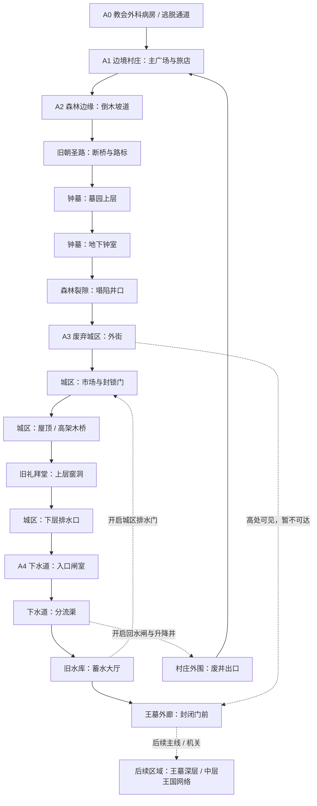

# Nereis Hero 第一阶段关卡拓扑设计（中文）

> 版本：Level Topology Phase 1 — Draft 0.1  
> 分支：development  
> 状态：关卡设计草案；用于后续制作，不代表所有房间已在 Godot 实现。  
> 约束：冻结现有角色技能、战斗系统与开场基线；本文件只定义空间关系、探索节奏和关卡职责。  
> 关联文档：[世界地图总纲](./WORLD_MAP_MASTER_PLAN_CN.md)、[开发者剧情记忆](./DEVELOPER_STORY_MEMORY.md)。

## 1. 本阶段的目标

先做出一段能验证整款游戏地图语言的垂直切片，而不是一次铺开整个王国。

本阶段覆盖：

- A0 教会外科病房与逃脱通道（复用现有开场，先盘点，不重做）。
- A1 边境村庄（复用现有 Village Hub）。
- A2 森林、钟墓与旧朝圣路。
- A3 废弃城区（第一个大型互通区域）。
- A4 下水道、旧水库与王墓入口（建立第一条真正改变空间认知的捷径）。

阶段目标不是做完五张互不相干的地图，而是让玩家在探索后理解：村庄、城区与王城之间存在一套被遗忘、被改建、又被教会封锁的旧交通网络。

## 2. 空间拓扑总图

图中每个节点代表一个关卡空间或具有独立玩法职责的房间组，不等于一个 Godot 场景。实线表示主探索连接；带有“解锁”说明的连接表示初次到达时不可用。

### 拓扑规则

- **A1 是情感枢纽，不是全能商店大厅。** 村庄负责人物关系、休息和路线分流；危险探索仍需玩家主动离开安全区。
- **A2 是第一个小环路。** 森林边缘与旧朝圣路提供方向感，钟墓是可选调查支线，森林裂隙则是进入城区的第二条路线。
- **A3 是第一个真正的箱状区域。** 至少存在外街入口、屋顶高路、礼拜堂上层和地下排水层之间的交叉关系。
- **A4 是认知反转区。** 玩家先把它当作城区下方的排水设施，后来发现它连接村庄旧井与更深的王墓。
- **王墓深层在本阶段只设置远期出口。** 不为了画完整图而提前制作后续区域。

## 3. 节点表：入口、职责与玩家认知

### A0 — 教会外科病房与逃脱通道

| 节点 | 空间职责 | 设计要求 |
|---|---|---|
| A0-01 外科病房 | 建立控制感与异常感 | 沿用当前开场与现有敌人安排 |
| A0-02 实验走廊 | 基础战斗与逃脱压力 | 通过门、尸体和实验痕迹暗示主角不是普通囚犯 |
| A0-03 维护通道 | 由封闭室内过渡到外部 | 只保留必要的回头路，不在序章堆收集品 |
| A0-04 外墙出口 | 单向离开教会 | 离开后不要求玩家马上理解地理位置 |

**地图功能：** A0 先让玩家感到自己逃出了一个封闭设施，不立即揭示设施位于王国的哪个方位。远处的钟声或建筑轮廓可以在之后再次出现，作为迟来的空间线索。

### A1 — 边境村庄

| 节点 | 空间职责 | 设计要求 |
|---|---|---|
| A1-01 村庄入口 | 连接 A0 与安全区 | 初次进入时给予喘息，不立即用敌群打断 |
| A1-02 主广场 | 路线分流与方向锚点 | 从这里能看到森林方向；天气好时可隐约看到远方高耸建筑 |
| A1-03 旅店 / 休息点 | 主要人物互动与重返锚点 | 保留现有 Village Hub 的交互结构 |
| A1-04 蜜忒附近的小路 | 情感线索与可选停留 | 不用显眼的恋爱数值或任务清单表达关系 |
| A1-05 旧井与封闭井道 | 早期不可用的地标 | 玩家初次只看到井口、锈蚀吊架或封死的检修门 |
| A1-06 森林出口 | 开始野外探索 | 用路标、倒木与远景明确主方向 |

**关键视觉承诺：** 玩家从广场能够辨认远处的王城或大圣堂，但中间有森林、雾、峭壁和废弃城区阻挡。不要让玩家误以为可以直线走过去。

**回访变化：** A4 的回水闸开启后，A1-05 的旧井出口成为快速返回路线。这个入口早期已出现，因此解锁时能产生“我早就见过这里”的回报。

### A2 — 森林、钟墓与旧朝圣路

| 节点 | 空间职责 | 设计要求 |
|---|---|---|
| A2-01 倒木坡道 | 第一个野外战斗空间 | 利用上下坡、遮挡和敌人视线，而不是长直走廊 |
| A2-02 猎人岔路 | 可选短支路 | 给出一件地方性遗物或一段不完整的证词 |
| A2-03 断桥观景点 | 建立远景与不可达空间 | 能看到城区高塔或大圣堂的轮廓，暂时不能直接跨越 |
| A2-04 朝圣路石阶 | 主路线与旧时代痕迹 | 石阶年代早于周围的教会标记；两种符号不要附带解释文本 |
| A2-05 钟墓上层 | 可选调查区域 | 墓碑与钟楼记录互相矛盾；不把答案写在同一件物品上 |
| A2-06 地下钟室 | 小型高风险探索 | 通过声音、绳索和钟体残骸暗示钟曾被人为改造 |
| A2-07 森林裂隙 | 通往 A3 的隐蔽入口 | 由塌陷地形形成；初次探索可进入，但返回路线较危险 |
| A2-08 旧朝圣路回环 | 返回森林边缘 | 打开短门或推倒障碍后，回程明显缩短 |

**主路线：** A1-06 → A2-01 → A2-03 → A2-04 → A2-07 → A3。

**可选路线：** A2-01 → A2-02；A2-04 → A2-05 → A2-06 → A2-08。

**设计底线：** 钟墓不应成为真结局必做的显眼任务。它首先是一段完整的地方故事；玩家可以拿到线索，也可以只记得那个不合常理的钟声。

### A3 — 废弃城区

A3 是第一块需要反复学习的主要区域。它不能只是“入口—清怪—Boss—出口”的线性关卡。

| 节点 | 空间职责 | 设计要求 |
|---|---|---|
| A3-01 外街入口 | 主路线落点 | 初见时从高处看见城区中层与地下排水口 |
| A3-02 倒塌民居 | 近距离战斗与可探索房间 | 房屋之间形成上下交错的短通路 |
| A3-03 市场广场 | 区域中心与方向锚点 | 从此处可以辨认礼拜堂、屋顶和封锁门 |
| A3-04 封锁门 | 早期不可通行的主地标 | 门的另一侧能听见水流或机械声，暂时不解释来源 |
| A3-05 屋顶木桥 | 高路与远景观察点 | 通过跳跃、攀墙或钩爪等现有能力到达；不新增技能 |
| A3-06 礼拜堂上层 | 上层入口与空间交叉点 | 从窗洞进入，能看到下方大厅与一扇无法从此侧打开的门 |
| A3-07 礼拜堂地面层 | 敌人压力与叙事空间 | 教会标记覆盖更古老的浮雕，但不能靠一张说明牌解释 |
| A3-08 地下排水口 | 进入 A4 的主连接 | 初次可到达入口，但水位或闸门限制深层路线 |
| A3-09 排水检修间 | 第一个捷径机关 | 从 A4 开闸后，能在城区内部打开一条短回路 |
| A3-10 旧升降井 | 后期垂直连接预留点 | 先作为可见但不可用的结构，不在首轮强行打通 |

**A3 必须至少有两个有效环路：**

1. **上层环路：** 外街 → 倒塌民居上层 → 屋顶木桥 → 礼拜堂上层 → 市场广场附近。
2. **下层环路：** 市场边缘 → 地下排水口 → 下水道 → 排水检修间 → 城区封锁门内侧。

上层环路服务于观察、平台移动和高风险奖励；下层环路服务于路线重构、短捷径与旧建筑关系。两者不必在第一次探索时都能走通。

### A4 — 下水道、旧水库与王墓外廊

| 节点 | 空间职责 | 设计要求 |
|---|---|---|
| A4-01 入口闸室 | 从城区进入地下 | 用水位线和维修痕迹显示这里曾经长期运作 |
| A4-02 分流渠 | 地下路线分岔 | 一侧通往旧水库，一侧被闸门封住并发出水声 |
| A4-03 维护桥 | 高低差与危险穿越 | 玩家能看见下层路径，但跳下去后不能原路返回 |
| A4-04 沉积大厅 | 战斗与探索混合区 | 旧王朝石材与教会后期管线并置 |
| A4-05 回水闸室 | 第一条大型捷径机关 | 开启后降低一段水位，并解锁通向村庄旧井的升降井 |
| A4-06 旧水库 | 区域中心 | 通过水位变化让同一房间在开启前后具有不同通路 |
| A4-07 王墓外廊 | 远期地标与封锁边界 | 玩家能确认地下结构继续深入，但本阶段不必进入王墓深层 |
| A4-08 村庄旧井出口 | 返回 A1 的捷径出口 | 首次从地下打开，之后成为快速回访路线 |
| A4-09 城区排水检修门 | 返回 A3 的捷径出口 | 从地下打开，回到熟悉的市场 / 封锁门附近 |

**首轮捷径解锁顺序：**

1. 玩家从 A3-08 进入 A4-01。
2. 探索 A4-02、A4-03、A4-04，逐渐发现下水道并非单纯排污设施。
3. 抵达 A4-05，操作回水闸。
4. A4-08 村庄旧井出口解锁，玩家能快速回到 A1。
5. 继续探索或从回环前往 A4-09，打开 A3 的地下检修门。
6. 玩家返回城区后，先前无法打开的封锁门或排水口从另一侧变得可用。

**认知反转：** 不用 NPC 告诉玩家“村庄就在城区附近”。让玩家从地下升井，亲眼看见自己熟悉的村庄边缘，再听见远处城区的钟声；由玩家自行推断距离与旧路的关系。

## 4. 首轮路线节奏

建议把第一次探索控制成以下节奏，而不是一路提高敌人数量：

1. **逃脱与缓冲（A0 → A1）：** 压迫感转为短暂安全，建立人物和空间记忆。
2. **轻度外出（A1 → A2）：** 让玩家第一次自由决定是否调查支路。
3. **第一次风险选择（钟墓）：** 奖励是发现与局部资源，不要求玩家立即理解。
4. **进入未知城区（A2 → A3）：** 视野变大、方向复杂度增加，建立第一个需要记忆地标的区域。
5. **路线受阻（A3 → A4）：** 玩家不能立即通过封锁门，需要下到地下寻找路径。
6. **空间顿悟（A4 → A1）：** 解锁旧井捷径，第一次把三个区域理解为同一张地图。
7. **回访与新选择（A1 / A3）：** 允许玩家补给、查看人物变化或继续深入；不强迫立刻追逐主线。

## 5. 锁、能力与世界状态

本阶段只使用现有能力和环境机关，不设计新的主角技能。

| 门槛类型 | 本阶段例子 | 设计原则 |
|---|---|---|
| 物理路线 | 高墙、屋顶断桥、窄平台 | 适配现有跳跃、二段跳、攀墙、冲刺与钩爪；不要让所有路径都要求全部能力 |
| 机关状态 | 回水闸、升降井、检修门 | 玩家操作后应能观察到远处水位、机械声或通路发生变化 |
| 单向落差 | 维护桥下层、森林裂隙内侧 | 落下前提供视觉提示；落点附近必须有新路线或有意义奖励 |
| 信息门槛 | 异常符号、墓钟、被遮盖的铭文 | 灵视可以增加可见证据，但不直接弹出“正确答案” |
| 远期锁定 | 王墓深层、旧升降井 | 早期只展示空间存在，不用无意义的钥匙门堆积 |

不要把每种技能变成同一种颜色的能力门。路线应该由地形逻辑决定，技能只是让玩家跨越原本可见的障碍。

## 6. 敌人、检查点与失败回程

本文件不锁定具体数值或敌人名单，先锁定遭遇职责：

- **森林：** 少量敌人配合遮挡、坡道和侧路，教学“观察地形后再接战”。
- **钟墓：** 低密度、较高环境压力，允许玩家在战斗外推断异常。
- **废弃城区：** 近战压力与高低差组合；避免同屏堆满远程攻击者。
- **下水道：** 用狭窄通道、可见水位和分岔制造紧张；避免连续多屏无分支长廊。
- **捷径附近：** 检查点到主要挑战之间不应重复播放整段无变化的战斗。捷径解锁要实质性缩短失败后的回程。
- **Boss：** 本阶段是否在 A3 或 A4 设置区域 Boss，待结合当前已实现 Boss 与正式关卡进度盘点后再决定；不要为了每个区域都有 Boss 而硬塞。

## 7. 环境叙事布点规则

每个节点最多承担一到两个清晰的叙事任务，避免所有房间都塞满线索。

- **A1 村庄：** 生活痕迹、日常关系、村民对远方教会的模糊认识。
- **A2 森林 / 钟墓：** 被遗弃的朝圣仪式、年代不一致的墓碑、无法互相印证的传闻。
- **A3 废弃城区：** 房屋被征用的痕迹、封锁方向、教会标记覆盖旧符号。
- **A4 下水道 / 水库：** 不同年代的管线、旧王朝石构、被后世封死的通道。

玩家应能只看见其中一部分，也能正常完成普通主线。隐藏证据要散落在不同区域，不能把完整真相放在 A4 的一本日记里。

## 8. Godot 场景拆分建议（暂定）

拓扑确认前不按“一房间一个场景”机械拆分。建议以可独立复用的空间段落为单位：

- A0：保留现有场景结构，除非审查发现明确缺陷。
- A1：保留现有 Hub 场景与交互系统。
- A2：森林主路、钟墓上层 / 地下钟室、朝圣路回环可作为独立场景组。
- A3：外街 / 市场、屋顶层、礼拜堂、地下排水连接按加载和状态持久化需求拆分。
- A4：入口闸室、分流渠 / 沉积大厅、旧水库 / 回水闸、村庄井口连接、城区检修门连接按实际关卡规模拆分。

跨场景捷径必须有明确的持久化状态：例如“回水闸已开启”“村庄旧井已解锁”“城区检修门已打开”。具体实现方式应复用现有项目状态系统，不在设计阶段提前新增第二套状态管理。

## 9. 阶段 I 验收标准

进入大规模场景制作前，逐项验证：

- [ ] 玩家能从 A0 自然进入现有 A1，不破坏当前存档 / 恢复流程。
- [ ] A1 中远景地标明确，但不让玩家误判为可直接抵达。
- [ ] A2 有一条清楚的主路和一条可选钟墓支路。
- [ ] A3 至少有一个上层环路和一个地下回环的结构预留。
- [ ] A4 能通过机关实际解锁返回村庄的捷径。
- [ ] 从村庄返回城区时，玩家能识别已走过的地标并理解空间关系。
- [ ] 捷径显著减少失败后的重复跑图。
- [ ] 普通路线不要求玩家收齐隐藏证据或理解完整古神真相。
- [ ] 现有角色能力足以覆盖计划中的路线，不需要为地图临时发明新技能。
- [ ] 地图复杂度来自选择、回环和垂直关系，而不是空旷距离。

## 10. 规模与工时校准

A0–A4 是第一阶段切片，不应按整款游戏的比例缩小。它的任务是验证地图语言，不是单独承担 40 小时。

整款游戏仍以 12–15 个主要区域为规划目标。普通路线约 40 小时、真结局约 60 小时、全收集约 80–120 小时均为设计目标，必须在可玩版本中通过首次通关记录校准。若试玩显示时长主要来自回程过长、重复敌人或无法理解的路线条件，应修改布局，而不是把它算作有效内容。

## 11. 下一步制作顺序

1. 盘点现有 A0 与 A1 的场景入口、出口、传送和持久化状态，避免重复造轮子。
2. 在 A2 先制作灰盒拓扑：森林主路、钟墓支路、裂隙入口与回环。
3. 用临时几何块验证 A3 的上下层关系与两个环路。
4. 最后验证 A4 的回水闸、村庄井口和城区检修门是否真正形成快捷回路。
5. 通过灰盒试玩后，再定屏幕尺寸、平台高度、敌人密度、装饰和叙事物品位置。

在灰盒回环验证之前，不批量制作背景、美术装饰或新增剧情过场。
