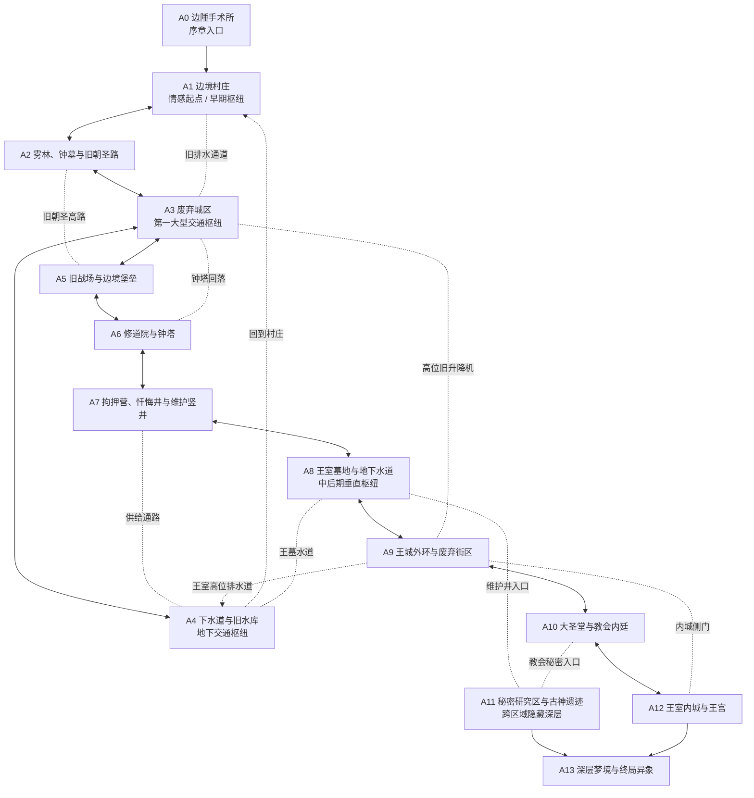

# 世界地图总脑图与空间关系（宏观版）

> **状态：宏观结构评审稿 v1。** 本文用于确定世界的空间骨架，不是玩家地图、房间平面图或实装证明。区域位置为相对方位；路线关系优先于精确比例。此阶段不锁定具体能力、支线、敌人或奖励。

## 1. 设计目标

先让玩家感受到这是一个彼此咬合的世界，而不是一串依次通关的关卡。地图需要有三个层次：

1. **地理表层**：村庄、荒野、城区、教会、王城，玩家能通过地标理解自己身处何处。
2. **交通骨架**：街道、屋顶、钟塔、下水道、王墓水道和维护通路，让区域在空间上互相解释。
3. **隐藏深层**：研究设施、古神遗迹与梦境，不一定在地表上占据独立位置，却能从不同区域的深处进入。

设计基准：箱庭互联、垂直分层、远处可见的目标、先看见后抵达、捷径回到熟悉地点。不要为了“复杂”而制造没有地理理由的连接。

## 2. 世界总脑图

**阅读说明：** 实线表示主要地理联系，虚线表示捷径或特殊通路。图中为便于阅读省略了部分同等级连接；权威连接 ID 仍以 `tools/world_map_topology.json` 的 C01–C24 为准。该图表达设计意图，不代表每条路已经在 Godot 中实现。

## 8. 与现有拓扑数据的交叉核对

现有 `tools/world_map_topology.json` 中有 14 个宏观区域和 24 条跨区域连接。按连接条数计算，A3 废弃城区有 6 条连接；A4 下水道与 A9 王城外环各有 5 条；A1 村庄与 A8 王室墓地各有 4 条。这个分布支持“城区、地下水系、王室墓地承担枢纽职责”的方向，但也提示 A3 可能过度集中交通功能。

- 本脑图表达的是**逐步开放后的整体关系**，不是玩家第一次抵达时所有通路均已开放。
- 部分捷径在初始状态锁定；例如村庄旧路、钟塔回落、高位旧升降机与王室侧门都需要后续开放。
- A4→A1 的水道回程在现有数据中是单向最终连接；终局入口 A11→A13、A12→A13 也按单向记录。后续不能为了图面整齐就擅自改成双向。
- 下一次地图审查重点是 A3 的交通负担、A4 与 A8 的地下连接是否过密，以及 A11 的秘密入口是否让真相过早可达。

以上为对现有设计数据的静态读取与统计，不是 Godot 实机验证，也不等于已经确认所有连接的游戏体验合格。

## 3. 六个大区域的空间定位

| 大区域 | 空间角色 | 主要职责 | 设计上应避免 |
|---|---|---|---|
| 边境村庄与荒野（A1/A2/A5） | 西北侧地表区域 | 建立人物关系、探索自由、边境战争痕迹 | 把村庄做成只去一次的序章 |
| 废弃城区与地下水系（A3/A4） | 世界中部的早中期交汇点 | 首个大型箱庭；地面、屋顶、地下互通 | 让所有路线都只经过城区而令其他区域失去意义 |
| 教会边陲与圣堂领地（A0/A6/A7/A10） | 西南至南部的纵深势力区域 | 从实验痕迹、日常信仰、拘押到权力中心逐层揭露 | 将教会设计成一条只向前推进的长走廊 |
| 王城与王室墓地（A8/A9/A12） | 东部地表与地下相互交叠 | 让王权、历史、基础设施和终局前选择彼此关联 | 让王墓成为与王城脱节的独立迷宫 |
| 秘密研究区与古神遗迹（A11） | 跨区域的隐藏深层 | 连接教会实验与王室维护体系，逐步破坏玩家对空间的信任 | 过早解释全部真相，或只做一条隐藏直线 |
| 深层梦境与终局异象（A13） | 世界逻辑的终局层 | 按路线与角色状态改变空间和遭遇 | 把结局差异缩减为换色或换 Boss |

这些方位是相对布局建议，而非地理坐标。后续绘制俯视地图时可以旋转或拉伸，但不应随意改变枢纽和连接的功能。

## 4. 枢纽设计：每个枢纽解决不同的问题

### A1 边境村庄：情感枢纽

玩家理解人物、生活和冲突。回访价值来自人物状态与村庄变化，而不是复杂交通。

### A3 废弃城区：路线枢纽

玩家第一次建立完整的空间认知：从地面发现高处，从高处俯瞰旧路，从地下绕回熟悉街区。它是地图认知的教学区，但不能垄断所有捷径。

### A4 下水道与旧水库：地下交通枢纽

它应让不同区域的“背面”相连。每条水道都要有可信的高低差、流向或维护用途，不能只用地下通道作为任意传送管。

### A8 王室墓地：垂直与历史枢纽

它同时是历史证据空间和交通交叉点。玩家通过水道、墓道、维护井理解王城与秘密研究区的联系。

### A11 秘密研究区：叙事枢纽而非普通交通枢纽

它可以在拓扑上连接多个区域，但不应变成方便快捷的万能捷径。每次深入都应改变玩家对教会、王室或古神的理解，并且保持必要的方向迷失感。

## 5. 主要路线与非主路线的分工

- **主线**负责推进人物冲突与势力关系，不应要求玩家探索每个隐藏分支。
- **捷径**负责回到熟悉的空间、减少重复路程，并奖励玩家对地形的理解。
- **隐藏路线**负责补充证据、能力选择、角色变化或不同战斗策略；不应只提供普通消耗品。
- **垂直路线**负责让玩家从不同高度重新理解同一地点，而不只是增加跳跃难度。
- **深层路线**负责把多个表层区域的线索汇聚起来，但允许普通路线玩家错过部分真相。

## 6. 当前应保留的开放问题

这些问题不阻止宏观设计继续推进，但在进入逐房间设计前应逐一裁定：

1. A3 是否承担了过多交通功能？若玩家总能经城区解决问题，荒野、教会和王城会不会失去独立性？
2. A4 与 A8 是否应该形成一条连续的地下骨架，还是通过不同高度和封闭段落保持探索节奏？
3. A11 的两个已知入口是否足够？后续可以考虑让它在空间上贴近更多区域，但不能因此过早开放。
4. A13 是否只在终局进入，还是允许玩家在中后期短暂窥见其边界？无论哪种选择，都要避免破坏结局的分量。
5. 六个大区域的视觉地标能否从远处或相邻层看见？每个区域至少应有一个能帮助玩家建立方向感的独特轮廓。

## 7. 设计边界与验收方式

当前只验收宏观地图是否值得探索、是否形成合理互联，不验收剧情对白或单个能力。

- 玩家能凭地标判断大致方位，而不必依赖小地图导航。
- 主线推进时会自然遇见至少一条可记忆的非主路线。
- 至少两个枢纽通过不同高度或地下路径发生联系。
- 捷径开放后能明显改变玩家对路线的理解。
- 隐藏深层既与表层有真实地理关系，又保留叙事上的陌生感。
- 普通路线可以通关；探索路线提供更完整但不强制的认知。

**当前结论：** 保留“城区是早中期路线枢纽、王室墓地是中后期垂直枢纽、秘密研究区是跨区域隐藏深层”的总体方向。进入小地图前，先用俯视空间草图核对大区方位、连接密度与枢纽负担；不提前把示例性的钩爪或某条支线锁定为必做内容。

## 第二轮宏观空间审查

已完成相对方位、垂直层次与 C01–C24 逐条连接审查。请参阅[《宏观地图空间布局与连接审查（第二轮）》](WORLD_MAP_SPATIAL_REVIEW_CN.md)。本轮裁定保留现有连接数量，重点防范 C05 软锁、A4 地下路线高度混淆，以及 A11 信息过早揭露。该审查仍是设计合同，不代表 Godot 实机验收。
