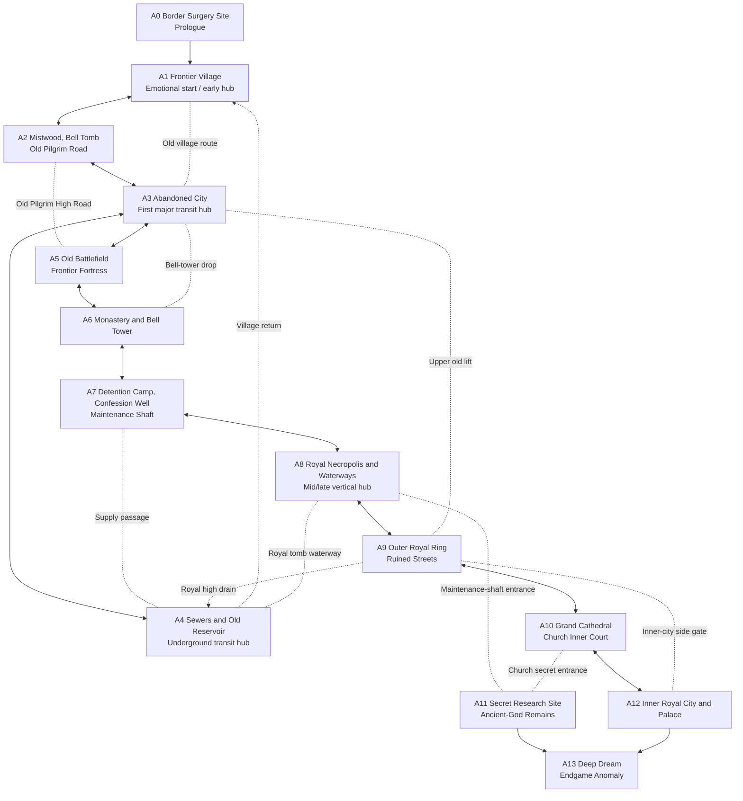

# World Map Brain Map and Spatial Relationships (Macro Draft)

> **Status: Macro-structure review draft v1.** This document defines the world's spatial skeleton. It is not a player map, room plan, or proof of implementation. Directions are relative; relationship between routes matters more than exact scale. No specific ability, quest, enemy, or reward is locked at this stage.

## 1. Design intent

The world should feel like an interlocking place, not a sequence of levels. It has three layers:

1. **Surface geography:** village, wilderness, city, Church, and royal city give players recognizable landmarks.
2. **Transit skeleton:** streets, rooftops, bell tower, sewers, royal waterways, and maintenance routes explain how regions physically connect.
3. **Hidden depth:** research facilities, ancient-god remains, and dream spaces may not occupy a separate surface district, yet can be entered from beneath multiple regions.

Baseline principles: interconnected box-world design, vertical layers, visible distant goals, seeing a route before reaching it, and shortcuts that return players to familiar places. Complexity must not replace geographic logic.

## 2. World brain map

**Reading note:** Solid lines represent major geographic relationships; dashed lines represent shortcuts or special passages. Some peer-level links are omitted for readability. The authoritative connection IDs remain C01–C24 in `tools/world_map_topology.json`. This diagram expresses design intent, not completed Godot implementation.

## 8. Cross-check against the current topology data

The current `tools/world_map_topology.json` contains 14 macro regions and 24 inter-region connections. By raw connection count, A3 (Abandoned City) has 6 links; A4 (Sewers/Reservoir) and A9 (Outer Royal Ring) have 5 each; A1 (Village) and A8 (Royal Necropolis) have 4 each. This supports the intended hub roles for the city, underworks, and royal tombs, but also flags a risk that A3 may concentrate too much transit responsibility.

- This brain map represents the **overall relationship after routes are progressively opened**, not the state in which every passage is available on first arrival.
- Some shortcuts begin locked, including the old village route, bell-tower drop, upper old lift, and royal side gate.
- The A4→A1 waterway return is recorded as a one-way final connection; the endgame entries A11→A13 and A12→A13 are also one-way in the data. Do not make them bidirectional merely to simplify the diagram.
- The next map review should focus on A3's transit workload, whether the underground connections between A4 and A8 are too dense, and whether the secret entrances to A11 expose the truth too early.

This is a static read and count of the design data, not an in-engine Godot test and not proof that every connection already provides a good player experience.

## 3. Spatial roles of the six macro areas

| Macro area | Spatial role | Primary function | Avoid |
|---|---|---|---|
| Frontier Village and Wilds (A1/A2/A5) | Northwest surface region | Character bonds, exploratory freedom, traces of frontier conflict | Making the village a one-time prologue |
| Abandoned City and Underworks (A3/A4) | Central early/midgame crossroads | First major box-world; connect street, roof, and underground | Making every route depend on the city and weakening all other regions |
| Church Frontier and Cathedral Domain (A0/A6/A7/A10) | Southwestern-to-southern power corridor | Reveal research, public worship, detention, and institutional power in layers | Turning the Church into a one-way corridor |
| Royal City and Royal Necropolis (A8/A9/A12) | Eastern surface and underground overlap | Interweave crown, history, infrastructure, and pre-endgame choices | Isolating the royal tombs from the royal city |
| Secret Research Site and Ancient-God Remains (A11) | Hidden depth beneath multiple regions | Connect Church experiments with royal maintenance systems and gradually destabilize spatial certainty | Explaining every mystery too early or making it one hidden straight line |
| Deep Dream and Endgame Anomaly (A13) | Endgame layer of world logic | Change spaces and encounters according to route and character state | Reducing ending differences to recolors or a different boss |

These are relative layout suggestions, not geographic coordinates. A future top-down map may rotate or stretch them, but should preserve the roles of hubs and links.

## 4. Hubs must solve different problems

### A1 Frontier Village: emotional hub

Players understand characters, everyday life, and conflict. Return value comes from character states and changes in the village, not complex traversal.

### A3 Abandoned City: route hub

Players build a complete spatial mental model for the first time: see upper routes from the street, look back at old streets from above, and return to familiar places through the underground. It teaches map literacy without monopolizing every shortcut.

### A4 Sewers and Old Reservoir: underground transit hub

It connects the “undersides” of different districts. Each waterway needs credible elevation, flow, or maintenance logic; the sewer should not be a universal teleport network.

### A8 Royal Necropolis: vertical and historical hub

It is both a historical evidence space and a transit junction. Waterways, tomb passages, and maintenance shafts reveal the relationship between the royal city and the hidden research site.

### A11 Secret Research Site: narrative hub, not a normal transit hub

It may connect to several areas topologically, but should not become a convenient universal shortcut. Each descent should change the player's understanding of the Church, crown, or ancient gods while preserving some spatial disorientation.

## 5. Division of responsibilities between routes

- **Main route** advances character conflict and faction relationships; it must not require every hidden branch.
- **Shortcuts** return players to familiar spaces, reduce repeated traversal, and reward understanding of terrain.
- **Hidden routes** provide evidence, optional abilities, character changes, or combat choices—not just common consumables.
- **Vertical routes** let players reinterpret the same place from another elevation instead of merely increasing platforming difficulty.
- **Deep routes** converge clues from multiple surface areas while allowing players on a straightforward route to miss some truths.

## 6. Open questions to preserve

These do not block macro design, but should be decided before room-by-room production:

1. Does A3 carry too much transit responsibility? If the city solves every navigation problem, will the wilderness, Church, and royal city lose their identities?
2. Should A4 and A8 form a continuous underground skeleton, or should elevation changes and sealed segments preserve discovery pacing?
3. Are the two known A11 entrances enough? More spatial adjacency may be explored, but must not make it accessible too early.
4. Is A13 entered only at the end, or can players glimpse its boundary in midgame? Either choice must preserve the weight of the ending.
5. Can players recognize a distinctive silhouette for each macro area from afar or from neighboring layers? Each area needs at least one landmark that helps orientation.

## 7. Design boundaries and review criteria

At this stage, review whether the macro map invites exploration and forms coherent links—not dialogue or individual abilities.

- Players can infer their rough direction from landmarks without relying entirely on a minimap.
- Main progression naturally reveals at least one memorable non-main route.
- At least two hubs connect through different elevations or underground paths.
- Opening a shortcut noticeably changes the player's understanding of the route.
- The hidden depth has real geographic ties to the surface while retaining narrative strangeness.
- A straightforward route remains completable; exploration offers richer but optional understanding.

**Current conclusion:** Keep the overall direction: the abandoned city is the early/midgame route hub, the royal necropolis is the mid/late vertical hub, and the secret research site is hidden depth spanning multiple areas. Before detailing small maps, review the relative positions, connection density, and hub workload on a top-down spatial sketch. Do not lock an illustrative grappling hook or a particular quest as mandatory content.
