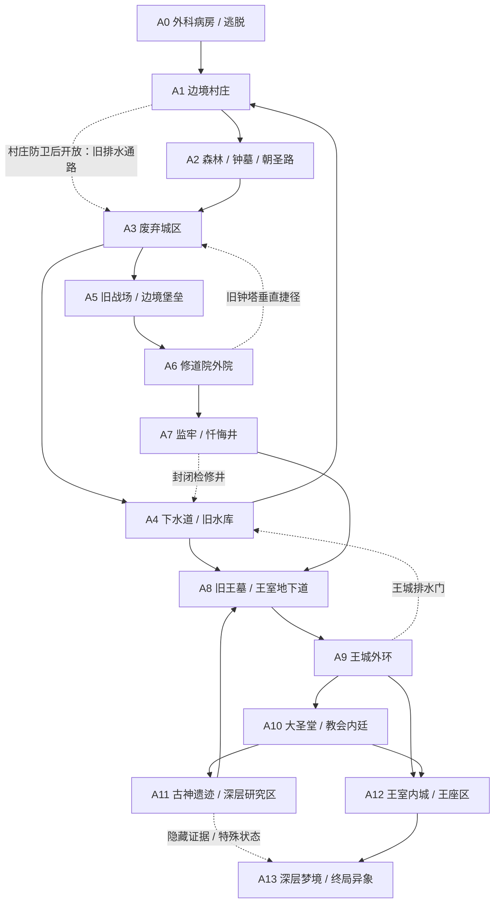

# Nereis Hero 全游戏区域网络与进程拓扑（中文）

> 版本：World Network Topology Draft 0.1  
> 分支：development  
> 状态：宏观关卡设计草案；不是最终剧情正史，也不代表区域已经实现。  
> 设计目标：约 40 小时普通通关、约 60 小时真结局路线、全收集目标约 80–120 小时。以上均为规划目标，必须通过试玩校准。  
> 关联文档：[世界地图总纲](./WORLD_MAP_MASTER_PLAN_CN.md)、[第一阶段关卡拓扑](./LEVEL_TOPOLOGY_PHASE_1_CN.md)。

## 1. 设计原则：十四个区域，一张王国地图

整款游戏暂定由 **14 个主要区域**组成。主要区域是有独立空间身份、路线选择与叙事主题的地理单元，不等于 14 个 Godot 场景。每个区域可以拆成若干房间场景、上下层或隐藏子区。

目标不是让玩家按 1→14 顺序逐个通关，而是建立三种相互交织的路线：

1. **地表主路：** 村庄、森林、旧朝圣路、废弃城区、军事旧道、王城外环。
2. **地下旧路：** 墓穴、下水道、水库、王墓、古代遗迹与研究设施。
3. **权力路线：** 修道院、监牢、教会内廷、大圣堂与王室深层。

三张“路线”不是三张独立地图。玩家会通过井口、塌陷地板、升降机、废弃祭坛、维修通道与封锁门在它们之间切换。

## 2. 十四个主要区域提案

| 编号 | 区域工作名 | 规模职责 | 首次进入的主要认知 | 后期用途 |
|---|---|---|---|---|
| A0 | 教会外科病房与逃脱通道 | 小型线性序章 | 主角是实验对象，但身份不明 | 作为记忆与视觉符号的参照 |
| A1 | 边境村庄 | 小型枢纽 | 安全、生活与蜜忒 | 多次回访、人物状态变化、旧井捷径 |
| A2 | 森林、钟墓与旧朝圣路 | 中型野外区 | 王国道路比现有教会秩序更古老 | 支线证据、通往城区的第二入口 |
| A3 | 废弃城区 | 大型枢纽 | 失踪、征用与封锁不是孤立事件 | 多入口、屋顶环路、地下网络交汇 |
| A4 | 下水道与旧水库 | 中大型地下区 | 地下结构连接不同地表地点 | 村庄与城区捷径、王墓入口 |
| A5 | 旧战场与边境堡垒 | 中型战斗区 | 王国以信仰扩张并非只有英雄传说 | 连接城区外围与修道院旧道 |
| A6 | 修道院外院 | 中大型区域 | 公开仪式与日常管理的双重面貌 | 通向监牢、旧钟塔与高层朝圣路 |
| A7 | 监牢与忏悔井 | 中型垂直区 | 惩戒、囚禁与实验之间的模糊边界 | 地下支路接入古代结构 |
| A8 | 旧王墓与王室地下道 | 大型地下区 | 王权历史存在官方版本之外的裂缝 | 连通王城内环与深层研究区 |
| A9 | 王城外环与废弃街区 | 大型枢纽 | 城市仍然运作，但部分地区已被清空 | 从高处与地下进入王城多个层级 |
| A10 | 大圣堂与教会内廷 | 大型权力区 | 官方信仰与教会权力结构 | 主线核心冲突与终局入口之一 |
| A11 | 古神遗迹与深层研究区 | 大型高风险区 | 教会是在利用更古老的遗迹，而非创造其力量 | 隐藏调查、真结局证据汇聚 |
| A12 | 王室内城与王座区 | 大型终局区 | 王权知情程度与其自我辩护 | 普通结局主线终点及政治冲突 |
| A13 | 深层梦境 / 终局异象 | 小到中型、状态变化区 | 熟悉空间在外神影响下变得不可信 | 永恒乐园与烈火天罚的终局变化 |

名称和具体顺序仍可调整。十四区的意义是确保游戏同时具备野外、聚落、城市、宗教设施、地下古迹和终局空间，不要求每区体量相同。

## 3. 全局区域连接图

此图只定义预期连接，不表示玩家第一次抵达就能通过所有边。后续应为每条连接标记开放阶段、方向性、能力需求和世界状态。

### 三条重要的跨区域环路

**环路一：村庄—森林—城区—下水道—村庄**

- 早期由 A1 → A2 → A3 → A4 单向推进。
- 开启 A4 回水闸后返回 A1。
- 后续开启 A3 排水检修门，形成更稳定的双向回环。
- 作用：让玩家第一次理解地表与地下连接，建立地图信任感。

**环路二：城区—旧战场—修道院—旧钟塔—城区**

- A3 的高处能看到 A6 的钟塔或修道院轮廓。
- 初期只能从 A3 外街经 A5 进入 A6。
- 后期从 A6 钟塔的维护层下降，可开启回到 A3 上层的单向捷径。
- 作用：让中期回访不是重新清理整条主路，而是从新的高度切入旧区域。

**环路三：下水道—旧王墓—王城外环—教会内廷—深层研究区—旧王墓**

- A4 早期只能看见王墓外廊。
- 中后期通过 A7 或 A9 打开王室地下道，进入 A8。
- A11 的深层研究区至少有一条回到 A8 的路径，避免它成为只有入口没有出口的剧情副本。
- 作用：将王权、教会和更古老遗迹放在同一张可探索的地理网络中，而不是靠对白宣布它们有关联。

## 4. 进程门槛：限制信息与路线，不要人为拖时长

| 阶段 | 可探索区域 | 主要限制 | 玩家应获得的认识 |
|---|---|---|---|
| 序章 | A0、A1 部分 | 逃脱后方向未知 | 主角被当作实验对象 |
| 第一段探索 | A1、A2、A3 外围 | 机关、水位、危险路线 | 村庄与城区之间存在旧道路 |
| 第一大回环 | A3、A4、返回 A1 | 回水闸与检修门 | 地下结构连接熟悉地点 |
| 中期扩展 | A5、A6、A7，并回访 A3/A4 | 关卡机关、敌人压力、政治事件 | 教会的公开秩序与实际运作不完全一致 |
| 王国深层 | A8、A9、A10 | 多入口与区域状态 | 王权与教会的历史不能只靠一种叙述解释 |
| 隐藏调查 | A11 及旧区支路 | 分散证据、危险支路、人物关系 | 古神研究与蜜忒相关的联系逐渐浮现，但不保证完全理解 |
| 结局路线 | A12、A13 与既有区域变化 | 玩家选择、关键物品与已发生事件 | 结局改变对既有空间的理解，而不是只换一段结尾动画 |

不要把每一个阶段都做成拿钥匙开同色门。限制方式应交替出现：地形不可达、机关状态、敌对势力控制、可选调查、人物事件与结局状态。

## 5. 区域规模分配

十四个区域不应平均分配游戏时长。建议采用以下比例作为首次规划，而非硬性验收数字：

- **大型枢纽（A3、A9）：** 反复探索、多个高度、多个入口和至少两条环路。
- **中大型主线区（A4、A6、A8、A10、A11、A12）：** 主要战斗、关键空间转折和区域状态变化。
- **中型连接 / 支线区（A2、A5、A7）：** 主题鲜明，路线紧凑，有可选支路或捷径。
- **小型情感 / 终局区（A0、A1、A13）：** 规模不一定大，但通过声音、状态变化和回访记忆提高分量。

估算游玩时长时，必须区分首次探索、战斗学习、捷径解锁后的回访、隐藏调查与全收集补漏。不能把玩家迷路或反复跑同一段路自动算成有效内容。

## 6. 结局与地图复用

三种结局共享大部分地理结构，改变的是玩家能理解什么、部分通道状态、区域表现和终局路径。

### 凡人之墓

- 主线以 A5、A6、A9、A10、A12 为主要权力冲突路线。
- 玩家可以不知道 A11 的完整用途，也可以错过蜜忒相关的深层证据。
- 结局关注教会被推翻后，复国军是否重演旧秩序的问题。
- 不得把“未探索隐藏地图”表现成普通结局的惩罚。

### 永恒乐园

- 通过既有的蜜忒关系进展与相应事件，改变 A13 及部分熟悉区域的呈现。
- 地图可以变得安静、美丽而不可信；优先复用玩家熟悉的空间，让变化更有情感冲击。
- 不需要为了结局再造一整套等规模的新地图。

### 烈火天罚

- A11 的隐藏证据与多条支线物品为结局提供背景，不以一条明确的“真结局任务链”直接告知玩家答案。
- A10、A12 与 A13 共同承担终局段落。
- 百名教徒场景是集中式演出与战斗压力，不要求把一百名角色扩展成一百条独立任务。
- 悲剧结果来自主角、蜜忒与外神影响之间的冲突，不把它简化为“收集齐物品即可获得好结局”。

## 7. 地图叙事的空间分工

- **地表：** 展示公开秩序、日常生活、军事道路、远景地标与被遗弃的聚落。
- **地下：** 展示被重复利用的旧结构、被封锁的交通、建筑年代冲突和被隐藏的用途。
- **宗教建筑：** 同一建筑可有公开礼仪空间、管理空间、惩戒空间和地下维护层；不同阶层对同一地点的认知应不同。
- **王室区域：** 通过防御朝向、旧道路、废弃入口和遗物表现王权如何保护自己，而不是用国王长篇自白解释。
- **终局异象：** 改变熟悉空间的比例感、声音与可见路径，但不要让玩家觉得此前的地图知识完全作废。

## 8. 主要区域的进入方式要求

在成本允许时，A3、A6、A8、A9、A10、A11 至少各有两种进入方式，其中一种可以是后期开启的捷径。替代入口要产生实际收益：缩短回程、绕开一场高风险遭遇、从新高度切入，或发现不同的环境证据。

每个区域都应回答：

1. 玩家第一次从哪里进入？
2. 玩家能从这里看见什么但暂时无法抵达？
3. 区域内部是否至少有一条支路、环路或垂直层级？
4. 哪个出口能连接已知区域？
5. 这个出口在第一次游玩时是否已可用？
6. 开启捷径后，失败回程具体缩短了多少？
7. 此区域是否有一个无法被其他区域替代的视觉或叙事特征？

## 9. 制作顺序与范围控制

### 第一步：A0–A4 灰盒

按《第一阶段关卡拓扑设计》验证森林、钟墓、废弃城区、下水道和村庄旧井之间的关系。当前不制作全量装饰。

### 第二步：A3–A8 中层网络

优先连接废弃城区、旧战场、修道院、监牢和旧王墓。重点验证第二条跨区域环路，避免中期变成单向章节串联。

### 第三步：A8–A12 权力中心

再制作王城外环、大圣堂、教会内廷和王室内城。确保玩家能从地表、地下和建筑内部不同高度理解这些区域。

### 第四步：A11、A13 隐藏与终局层

隐藏区域应从已有路线自然分出，并与先前物品、环境、人物经历产生关联。终局变化优先复用熟悉空间。

### 第五步：实测时长与删改

记录首次通关、真结局路线和全收集的实际时间；统计玩家停滞、回程、迷路和重复战斗的来源。若内容不够，优先扩展有新空间关系的支路，而不是拉长走廊。

## 10. 本文件的下一轮工作

宏观区域连接确定后，下一步应给 A5–A8 画节点级拓扑图，明确旧战场如何接入修道院、修道院钟塔如何回到废弃城区、监牢如何进入王室地下道，以及旧王墓如何与 A4 的早期封闭入口呼应。

在 A0–A4 的灰盒回环得到验证之前，不建议同时启动全部十四个区域的场景制作。
