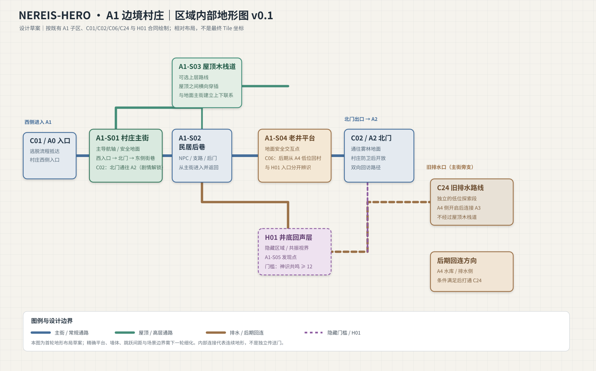

# A1 边境村庄｜区域内部地形图 v0.1

## 目标
把 A1 从一个世界拓扑节点展开为连续可探索的区域内部地形，作为后续 Godot 地形制作依据。此图是布局草案，不是最终像素坐标或已实现的场景。

## 沿用的既有约束
- A1-S01：村庄主街，初始导航轴。
- A1-S02：民居后巷，NPC 与支路。
- A1-S03：屋顶木栈道，可选屋顶探索路线；C24 不经过这里。
- A1-S04：老井平台，安全交互点；A4 的 C06 回村出口落在这里。
- A1-S05：井底回声层入口，对应 H01。
- C01：从 A0 的序章流程抵达 A1 西侧入口。
- C02：村庄北门通往 A2；村庄防卫完成后开放，双向回访。
- C24：旧排水探索路线；防卫后先开放短段探索，A4 侧打开后才形成通往 A3 的持久连接。
- H01：从老井进入，要求共振视界有效且神识共鸣达到 12；进入后可返回 A1，后续可与 A4 侧共享开启状态。

## 地形意图
1. 地面主街承担导航轴与北门方向辨识。
2. 民居后巷是从主街偏离的可回返支路，不把 NPC 全塞在主线上。
3. 屋顶木栈道形成上层横向路线，和地面保持多处空间关联。
4. 老井平台承担安全交互、H01 发现点和 C06 后期回村落点，但三者入口必须可区分。
5. 旧排水路线作为独立的低位探索段，不与屋顶路线混为一条，也不提前开放到 A3。
6. 本图没有将每条 SC 内部连接做成独立传送门；它们表示连续地形中的可行走相邻区域。

## 下一轮需要落实
- 确认实际村庄场景边界与角色出生点。
- 按项目 tile / 缩放确定网格单位。
- 标出每段地面、屋顶平台、墙体、梯子/跳跃连接和不可通行区域。
- 验证屋顶路线不成为强制主路，老井 H01 不与 C06 出生点重叠。
- 运行 C01、C02、C06、C24 与 H01 的实机路径验收。

## 状态
layout_draft_not_runtime_verified
