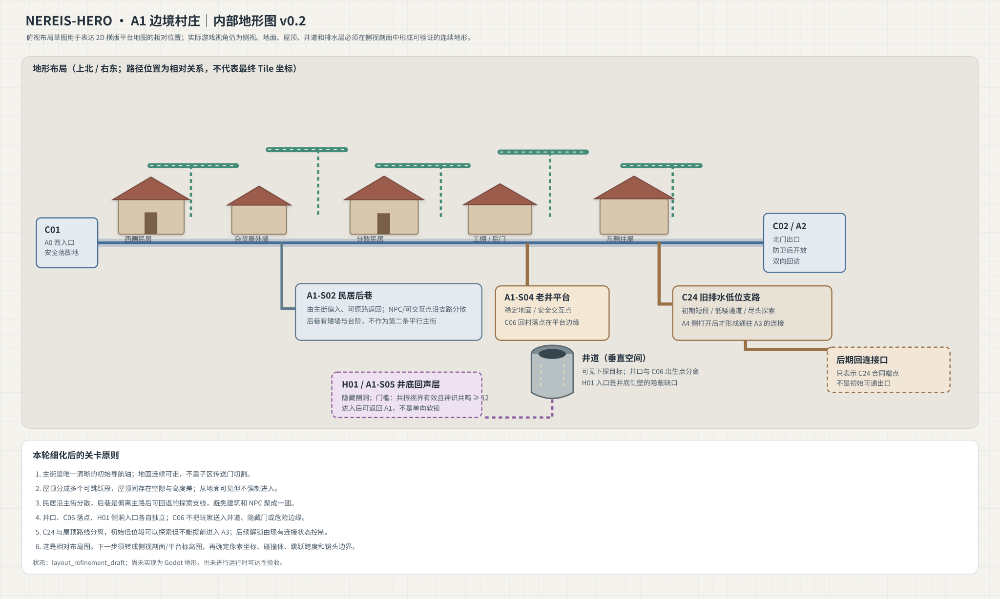

# A1 边境村庄｜区域内部地形图 v0.2（架构修订）

> 修订说明：本文件原先把 A1 当作一张连续区域并规划屋顶高路。当前工程决策改为 A1.0 + A1.1 两个场景；旧图只保留为历史布局参考，不能再作为当前场景拆分或屋顶路线的实施依据。

## 当前空间划分

- **A1.0 边境村庄生活区**：C01 西入口、主街、住宅、商店、工坊、民居后巷、老井与 C24 低位排水支路。保留 C02 北门、C06 回村、H01 井底入口和 C24 的既有解锁合同。
- **A1.1 教堂与后山**：教堂、酒馆、后山石阶、悬崖小径与观景平台；崖下洞窟的 H09 入口地标也归属这里。教堂和酒馆内部继续使用现有室内场景。
- A1.0 与 A1.1 之间使用显式入口/返回交互和安全出生点，不把连接只画在地图上。

## 视觉方向

使用 2.5D 观感：远山、建筑立面、前后景层次和遮挡提供纵深；玩家移动与碰撞仍为横版侧视。这里的“后山路线”是独立地形，不是屋顶路线。

## Godot 实现场景规范

- 地形、台阶、平台、边界、建筑轮廓、互动锚点尽量作为 `.tscn` 内可检查的节点。
- `StaticBody2D` 和 `CollisionShape2D` 决定真实承托；`Polygon2D`、`Line2D` 负责可见轮廓。可走地形和纯背景装饰不可混为一谈。
- 脚本主要处理剧情状态、互动、保存和场景切换。后续继续把 A1.0 中的常驻建筑和交互节点从代码生成迁移到场景文件。
- 老图中绿色屋顶线段和“屋顶高路”说明已过期，不能据此新增屋顶平台或屋顶奖励。

## 验收状态

当前已将 A1.1 作为独立场景，场景内含 Hero、教堂/酒馆轮廓、碰撞楼梯、悬崖观景平台、边界、教堂/酒馆/回村 POI 和条件开启的崖下洞窟交互门。A1.0 已移除屋顶路线渲染和屋顶路程单奖励，并移出崖下洞窟入口逻辑。

以上为源码层面改造记录，不代表已经完成本地 Godot 运行时验收。仍需检查楼梯连续可走、场景转场、悬崖边界、碰撞与镜头、教堂/酒馆交互及存档恢复。
