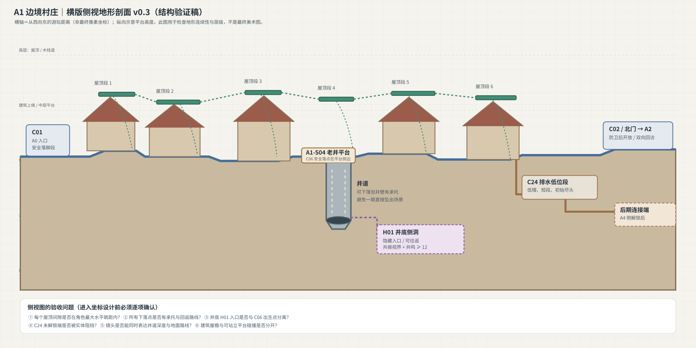

# A1 横版侧视地形剖面 v0.3

## 用途

这是从 v0.2 相对布局继续推进的**结构验证图**。它明确按 2D 横版侧视来表达：地面主街、可站立屋顶段、垂直井道、井底隐藏侧洞、低位排水路线和北门出口。横纵位置仅为示意，不是最终像素坐标。

## 侧视地形结构

- **地面主路**：从 C01 西入口连续延伸到 C02 北门；地面高度可以有小幅变化，但不得产生未经设计的断层或软锁。
- **屋顶路线**：多个独立的平台段，依附于民居/木结构，段间有空隙。需要根据实际角色跳跃参数确定间距，不能直接把示意图上的间隙当成可跳。
- **老井**：井口平台与井道是不同空间职责。井道要有侧壁、落下空间与底部承托；避免镜头/碰撞边界让玩家落出地图。
- **C06 返回落点**：放在老井平台旁的安全地面，不能与井口、H01 侧洞触发区或 C24 路径重合。
- **H01**：位于井底侧壁的隐藏支洞；门槛沿用既有合同，进入后可回返 A1。
- **C24**：从地面东段进入低位通道，初始只开放短段；A4 侧解锁后才建立跨区连通。

## 坐标化前必须取得的工程参数

1. Hero 的实际碰撞盒尺寸、地面速度、跳跃初速度/重力、可变跳高度和下落控制。
2. 当前 A1 场景/摄像机可用的坐标系、缩放、TileMap 或 TileMapLayer 网格尺寸。
3. 场景边界、地面碰撞层、门/交互触发器层与玩家出生点的现有定义。
4. C01、C02、C06、C24、H01 在当前项目中的实际节点/状态合同。

## 当前状态与下一步

本图仍是设计示意，**没有**声称通过跳跃可达性或 Godot 运行时验收。下一步先从仓库读取 Hero 物理参数与现有 A1 场景，再将这张结构图转换为带坐标的地形合同；每一段屋顶跳跃、井道落点、C24 阻挡状态和场景边界都要由实际参数验证。
