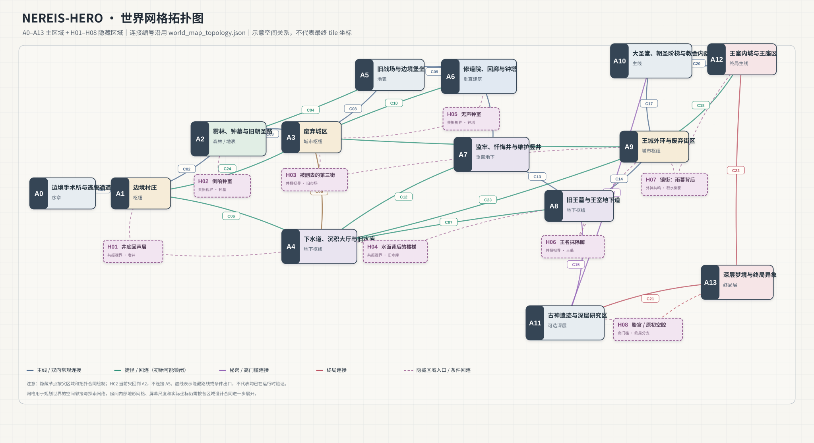

# Nereis-Hero 世界网格地图（主区域 + 隐藏区域）

- 主区域：A0–A13（14 个）
- 隐藏区域：H01–H08（8 个）
- 宏观连接：C01–C24（24 条）
- 主图中的 C 编号、区域 ID 和隐藏区域 ID 沿用 `tools/world_map_topology.json`。
- 这是**世界拓扑网格图**：表达区域邻接、主线、捷径、隐藏路线与终局连接，不是最终的 TileMap 坐标图，也不宣称所有连接已完成运行时验证。
- H02「倒响钟室」按当前合同只返回 A2；没有把已撤销的 A5 第二出口重新加入。
- 隐藏区域的门槛（共振、古代暴露、外层暴露、异常来源和终局判定）以 `tools/world_map_topology.json` 为准。

## 图例
- 实线蓝色：主线连接
- 绿色：捷径 / 回连（部分需从远端解锁）
- 紫色：秘密连接
- 红色：终局连接
- 紫色虚线：隐藏区域入口或条件出口

## 设计边界
本图保留现有 A0–A13、C01–C24、H01–H08 的世界结构，只把它们转译为可读的网格拓扑图；没有重定义区域身份，也没有擅自增加跨区连接。下一阶段再按区域把内部地形拆成房间网格图。
